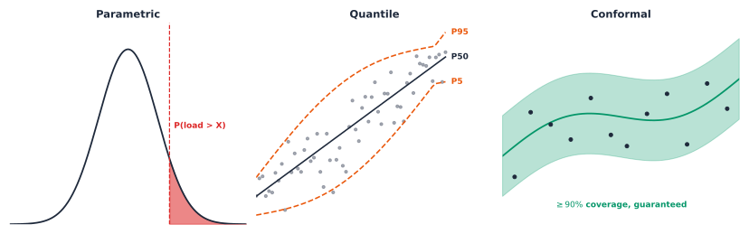

# Illustrations for the blog

Concept diagrams from the book *Machine Learning for Distribution Networks*, drawn as SVG with the text converted to
outlines, so they need no fonts and stay sharp at any size. Each is transparent with dark ink, so the class
`figure-illustration` puts it on a white mat that also reads well in the dark theme.

## Use in a post

```markdown
{.figure-illustration fig-alt="Describe what the figure shows, not its title." width="90%"}
```

Write the `fig-alt` from what the diagram shows. The alt text below is only a starting point from the file name.

## Catalogue

| File | Title | Fits posts on | KB |
|---|---|---|---|
| `archetype-distance-and-conformal.svg` | Archetype distance and conformal | Forecasting and uncertainty | 72 |
| `choosing-k.svg` | Choosing k | Machine learning | 45 |
| `cluster-confidence-set.svg` | Cluster confidence set | Machine learning | 42 |
| `component-selection.svg` | Component selection | Machine learning | 41 |
| `cross-population-retrieval-trust.svg` | Cross population retrieval trust | Forecasting and uncertainty | 50 |
| `customer-feeder-network-aggregation.svg` | Customer feeder network aggregation | Distribution networks | 53 |
| `customer-shape-vs-magnitude.svg` | Customer shape versus magnitude | Distribution networks | 66 |
| `diversity-weighted-ranking.svg` | Diversity weighted ranking | Machine learning | 42 |
| `forecastability-persistent-vs-volatile.svg` | Forecastability persistent versus volatile | Forecasting and uncertainty | 74 |
| `fpqr-vs-standard-qr.svg` | FPQR versus standard QR | Forecasting and uncertainty | 41 |
| `grid-centralized-vs-decentralized.svg` | Grid centralized versus decentralized | Distribution networks | 76 |
| `known-vs-new-customer-routing.svg` | Known versus new customer routing | Distribution networks | 55 |
| `lever-applicability-by-violation-type.svg` | Lever applicability by violation type | Distribution networks | 34 |
| `multi-task-shared-encoder-dual-heads.svg` | Multi task shared encoder dual heads | Machine learning | 33 |
| `net-injection-offset.svg` | Net injection offset | Distribution networks | 26 |
| `nilm-activation-extraction.svg` | NILM activation extraction | NILM | 38 |
| `nilm-frequency-split.svg` | NILM frequency split | NILM | 32 |
| `nilm-single-vs-multi-appliance.svg` | NILM single versus multi appliance | NILM | 67 |
| `nilm-softmax-vs-sigmoid.svg` | NILM softmax versus sigmoid | NILM | 64 |
| `nilm-transient-steady-state.svg` | NILM transient steady state | NILM | 33 |
| `nilm-wrg-pipeline.svg` | NILM WRG pipeline | NILM | 48 |
| `per-customer-vs-network-view.svg` | Per customer versus network view | Distribution networks | 64 |
| `pseudo-measurement-observability.svg` | Pseudo measurement observability | Distribution networks | 35 |
| `pv-vs-ev-failure-mode.svg` | PV versus EV failure mode | Distribution networks | 29 |
| `resampling-validity.svg` | Resampling validity | Forecasting and uncertainty | 133 |
| `same-blind-spot.svg` | Same blind spot | Forecasting and uncertainty | 60 |
| `separation-index-blind-spot.svg` | Separation index blind spot | Forecasting and uncertainty | 58 |
| `three-uq-paradigms.svg` | Three UQ paradigms | Forecasting and uncertainty | 50 |
| `trained-specialist-vs-zero-shot.svg` | Trained specialist versus zero shot | Machine learning | 45 |
| `trust-gated-composite-score.svg` | Trust gated composite score | Forecasting and uncertainty | 61 |
| `voltage-correlation-vs-magnitude.svg` | Voltage correlation versus magnitude | Distribution networks | 81 |
| `voltage-vs-thermal-position.svg` | Voltage versus thermal position | Distribution networks | 67 |
