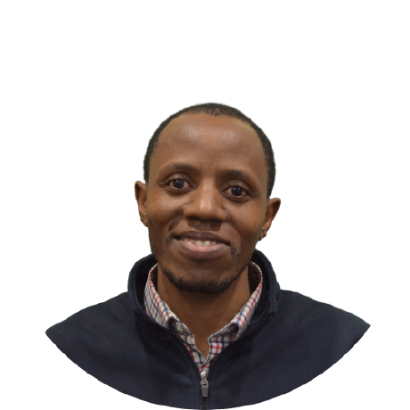

# Anthony Faustine

Principal ML Engineer\
Analog Devices, Ireland

[ GitHub](https://github.com/sambaiga) [ LinkedIn](https://www.linkedin.com/in/sambaiga) [ Google Scholar](https://scholar.google.com/citations?user=nhzHBTQAAAAJ&hl=en) [ ORCID](https://orcid.org/0000-0002-7838-533X) [ Email](mailto:sambaiga@gmail.com)

At [Analog Devices](https://www.analog.com) I design and run machine learning systems for supply chain planning and intelligent edge products, taking ideas from early prototypes to reliable production systems. Over the past decade I have worked across manufacturing, industrial, energy and semiconductor domains.

My technical work centres on probabilistic time series forecasting, Bayesian modelling and production MLOps. I care about clean architecture, robust deployment, and monitoring and governance once systems are live, and I work with business and product leaders to align technology roadmaps and AI investments with the value they are meant to create. I have a strong interest in innovation and technology management.

Alongside my industry role, I am active in research. My research develops methods and approaches for time series analysis and forecasting, mostly for power systems, from non-intrusive load monitoring to probabilistic net-load forecasting for low-voltage networks. I collaborate with [Lucas Pereira](https://www.alspereira.info/) at ITI, LARSyS, Técnico Lisboa on machine learning and data analytics solutions for clean energy systems and the broader energy transition.

### Education

- **PhD in Computer Science and Engineering**\
  Instituto Superior Técnico (Técnico Lisboa), Portugal
- **MSc in Leadership, Innovation and Technology**\
  Technological University Dublin (TU Dublin), Ireland
- **MSc in Telecommunications Engineering**\
  University of Dodoma, Tanzania

### Open to

I am open to research collaborations, technical speaking, and mentoring emerging AI engineers.

[Download CV ](../../files/Anthony_CV_2026_ADI.pdf) [Schedule a chat ](https://calendly.com/sambaiga)
