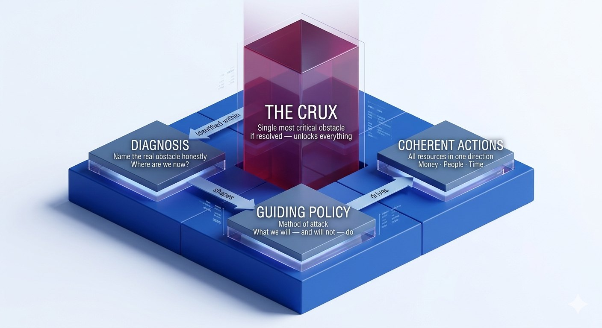
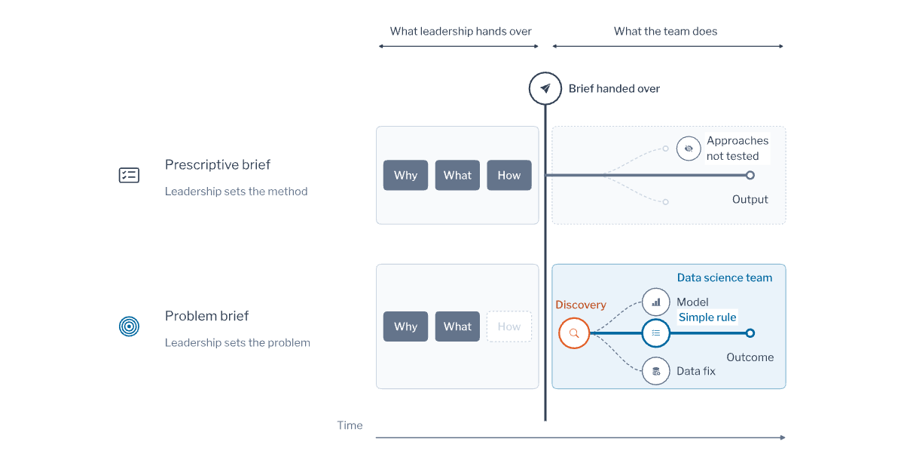
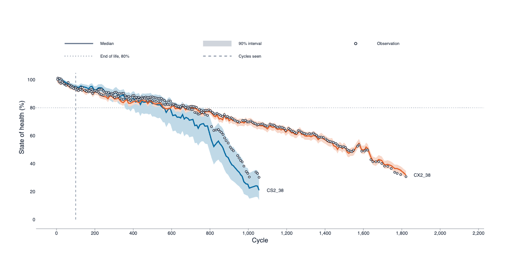
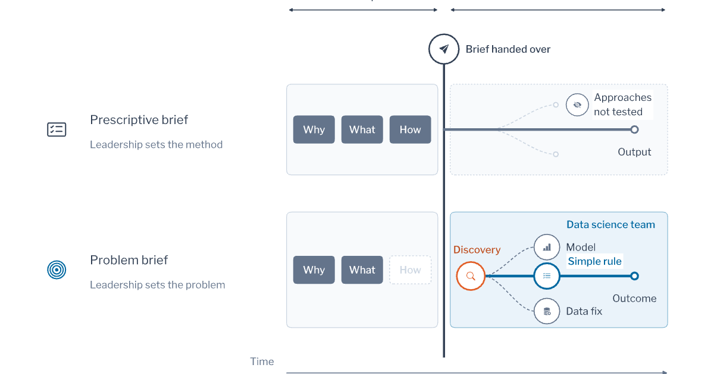
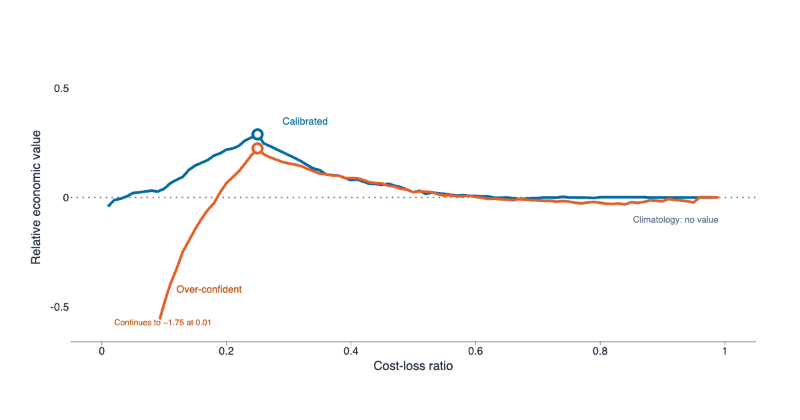
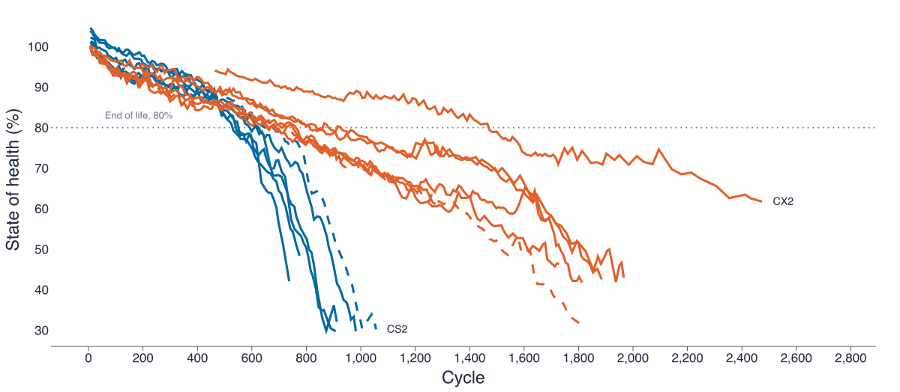
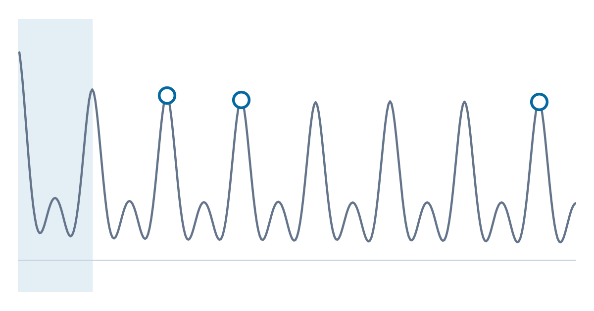
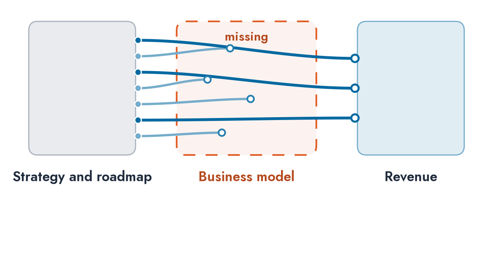
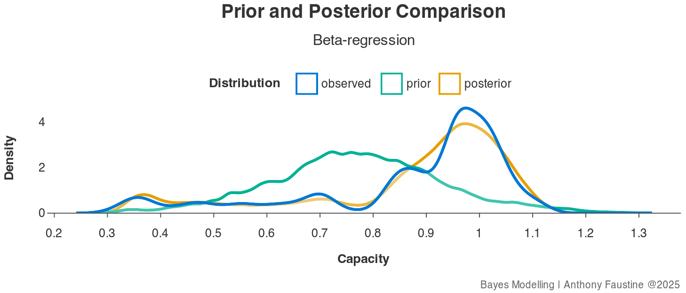
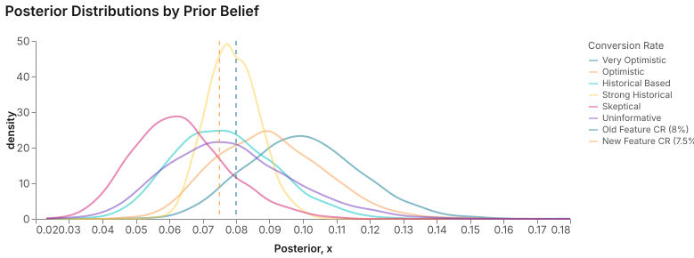

Essays by Anthony Faustine on machine learning strategy, technology management and high-performing teams.

Author

Affiliation

[Anthony Faustine](https://sambaiga.github.io/) [![]()](https://orcid.org/0000-0002-7838-533X)

Analog Devices, Ireland.

# Blog

13 posts · 4 topics · [RSS](index.xml)

[All 13](#) [Leadership and teams 4](#) [Bayesian modelling 4](#) [AI strategy 3](#) [Forecasting 2](#)

Start here AI strategy series, part 1 of 3

## [The Strategic Kernel and the AI Strategy Gap](../../pages/blog/posts/2026/03/index.llms.md)

AI investment is surging, yet 80% of organisations running pilots have extracted almost no measurable value. This post applies Rumelt's strategic kernel and technology roadmapping to diagnose why, and presents a framework for building an AI strategy that is…

Mar 28, 2026 · 12 min read

[Read the post](../../pages/blog/posts/2026/03/index.llms.md)

[ Leadership and teams ](../../pages/blog/posts/2026/11/2026-11-28-brief-the-problem.llms.md)

Nov 28, 2026 · 7 min read

### [Briefing a Data Science Team on the Problem and Not the Method](../../pages/blog/posts/2026/11/2026-11-28-brief-the-problem.llms.md)

A leader who writes the brief as a problem divides the work with the team, keeps the constraints and the review points, and specifies the method only where maturity, regulation, safety or urgency require it.

[Read more about Briefing a Data Science Team on the Problem and Not the Method ](../../pages/blog/posts/2026/11/2026-11-28-brief-the-problem.llms.md)

[ Bayesian modelling ](../../pages/blog/posts/2026/11/2026-11-28-hierarchical-bayesian-retirement.llms.md)

Nov 28, 2026 · 18 min read

### [Hierarchical Bayesian Regression for Battery Capacity: Predicting New Cells and Retiring Them](../../pages/blog/posts/2026/11/2026-11-28-hierarchical-bayesian-retirement.llms.md)

This post tests a hierarchical Beta regression of battery state of health on two cells that it never saw, compares it with one curve for all cells, one curve for each cell and a control without diagnostics, and turns the probabilities into the retirement…

[Read more about Hierarchical Bayesian Regression for Battery Capacity: Predicting New Cells and Retiring Them ](../../pages/blog/posts/2026/11/2026-11-28-hierarchical-bayesian-retirement.llms.md)

[ Leadership and teams ](../../pages/blog/posts/2026/11/2026-11-25-who-owns-the-method.llms.md)

Nov 25, 2026 · 10 min read

### [Who Owns the Method in a Data Science Team](../../pages/blog/posts/2026/11/2026-11-25-who-owns-the-method.llms.md)

A method prescribed from above costs a data science team the knowledge that sits close to the data, its commitment to the result and the early report of a failure, and a leader who sets the problem and its constraints gets work that the team owns.

[Read more about Who Owns the Method in a Data Science Team ](../../pages/blog/posts/2026/11/2026-11-25-who-owns-the-method.llms.md)

[ Forecasting ](../../pages/blog/posts/2026/11/2026-11-24-forecast-value-events.llms.md)

Nov 24, 2026 · 13 min read

### [Forecast Value, Part 1: Events and Their Value](../../pages/blog/posts/2026/11/2026-11-24-forecast-value-events.llms.md)

This post defines the decision, the event, the probability of the event from a quantile forecaster and from a Laplace forecaster, and the two scores that measure its quality and its value, the Brier score and the relative economic value.

[Read more about Forecast Value, Part 1: Events and Their Value ](../../pages/blog/posts/2026/11/2026-11-24-forecast-value-events.llms.md)

[ Bayesian modelling ](../../pages/blog/posts/2026/11/2026-11-21-hierarchical-bayesian-regression.llms.md)

Nov 21, 2026 · 21 min read

### [Hierarchical Bayesian Regression for Battery Capacity: Pooling across Cells and Chemistries](../../pages/blog/posts/2026/11/2026-11-21-hierarchical-bayesian-regression.llms.md)

This post extends the Beta regression of battery state of health to a hierarchical model with cells nested in chemistries, shows the priors before and after the data, checks how far the conclusions depend on the prior of the precision, and scores the model…

[Read more about Hierarchical Bayesian Regression for Battery Capacity: Pooling across Cells and Chemistries ](../../pages/blog/posts/2026/11/2026-11-21-hierarchical-bayesian-regression.llms.md)

[ Forecasting ](../../pages/blog/posts/2026/11/2026-11-21-lookback-lags-and-input-ranking.llms.md)

Nov 21, 2026 · 17 min read

### [Choosing the Lookback Window, Lags and Inputs of a Forecaster](../../pages/blog/posts/2026/11/2026-11-21-lookback-lags-and-input-ranking.llms.md)

This post shows how the autocorrelation function sets the lookback window and the lags of a forecaster, and how six measures of relevance rank lags, calendar variables and weather, first within subgroups and then together, on household, EV, PV and net-load…

[Read more about Choosing the Lookback Window, Lags and Inputs of a Forecaster ](../../pages/blog/posts/2026/11/2026-11-21-lookback-lags-and-input-ranking.llms.md)

[ AI strategy Part 3 of 3 ](../../pages/blog/posts/2026/05/index.llms.md)

May 6, 2026 · 25 min read

### [The Missing Layer: How AI Business Models Capture Value](../../pages/blog/posts/2026/05/index.llms.md)

Having a coherent AI strategy is not the same as having a business model that captures the value AI creates. This post introduces the AI Business Model Innovation Framework, which shows how organisations can translate strategic direction into revenue…

[Read more about The Missing Layer: How AI Business Models Capture Value ](../../pages/blog/posts/2026/05/index.llms.md)

[ AI strategy Part 2 of 3 ](../../pages/blog/posts/2026/04/index.llms.md)

Mar 29, 2026 · 38 min read

### [From Framework to Practice: A Five-Step AI Roadmapping Process](../../pages/blog/posts/2026/04/index.llms.md)

Knowing what the strategic kernel requires is not enough. This post walks through a five-step AI roadmapping process built around Rumelt's kernel and gives the diagnostic tools to recognise a weak AI strategy before it incurs cost.

[Read more about From Framework to Practice: A Five-Step AI Roadmapping Process ](../../pages/blog/posts/2026/04/index.llms.md)

[ Bayesian modelling ](../../pages/blog/posts/2025/12/2025-12-1-bayesian-regression..llms.md)

Dec 17, 2025 · 12 min read

### [Bayesian Regression: A Real-World Battery Degradation Case Study](../../pages/blog/posts/2025/12/2025-12-1-bayesian-regression..llms.md)

This post fits a Beta regression of battery state of health to six cells of one chemistry with PyMC, and tests it by predicting each cell from the other five, with and without the diagnostics.

[Read more about Bayesian Regression: A Real-World Battery Degradation Case Study ](../../pages/blog/posts/2025/12/2025-12-1-bayesian-regression..llms.md)

[ Bayesian modelling ](../../pages/blog/posts/2025/10/2025-10-10-bayesion-foundation.llms.md)

Oct 10, 2025 · 11 min read

### [Understanding Bayesian Thinking for Industrial Applications](../../pages/blog/posts/2025/10/2025-10-10-bayesion-foundation.llms.md)

This post learns the failure rate of a new machine from a short pilot with a Gamma prior and PyMC, checks the sampler against the exact answer, and shows how the choice of prior changes a decision about a service contract.

[Read more about Understanding Bayesian Thinking for Industrial Applications ](../../pages/blog/posts/2025/10/2025-10-10-bayesion-foundation.llms.md)

[ Leadership and teams ](../../pages/blog/posts/2024/09/index.llms.md)

Sep 10, 2024 · 6 min read

### [Individual Effort and Group Forces: Lewin’s Theory of Organisational Change](../../pages/blog/posts/2024/09/index.llms.md)

This post uses Kurt Lewin’s theory of group dynamics to show that lasting organizational change depends less on individual effort and more on engaging and transforming the collective forces within groups.

[Read more about Individual Effort and Group Forces: Lewin’s Theory of Organisational Change ](../../pages/blog/posts/2024/09/index.llms.md)

[ Leadership and teams ](../../pages/blog/posts/2024/07/index.llms.md)

Jul 12, 2024 · 4 min read

### [Shared Mental Models: The Invisible Architecture of High-Performance Teams](../../pages/blog/posts/2024/07/index.llms.md)

This post describes shared mental models, the common understanding of goals, roles and teamwork, and why they form the foundation of high-performing teams.

[Read more about Shared Mental Models: The Invisible Architecture of High-Performance Teams ](../../pages/blog/posts/2024/07/index.llms.md)
