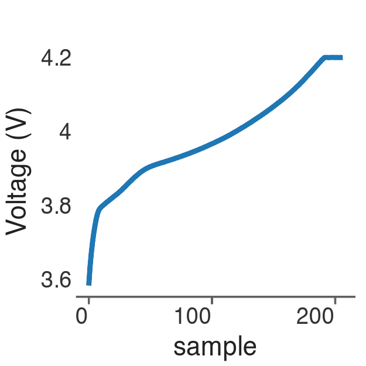
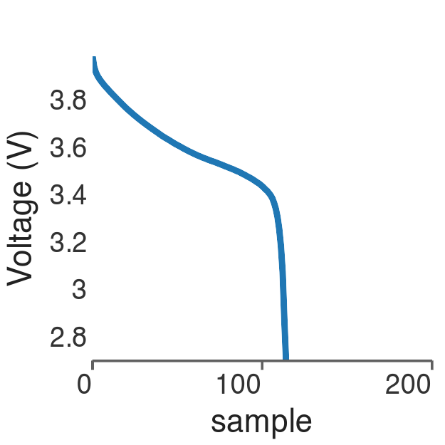
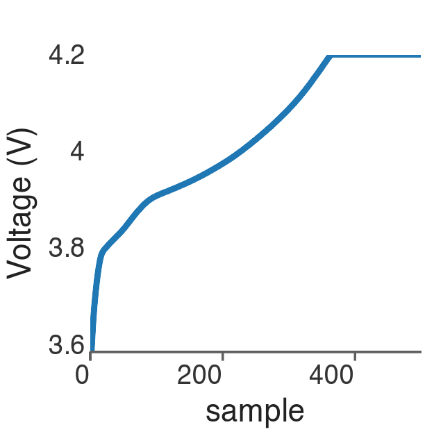
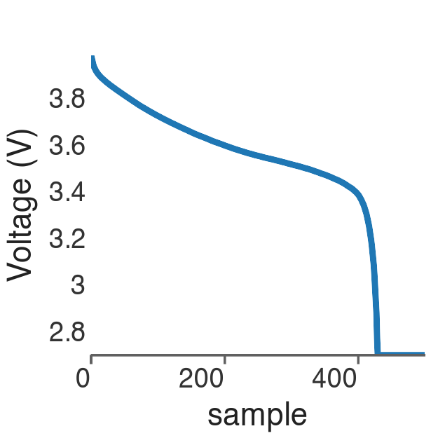

### Introduction

Welcome back to our series on *Bayesian Modelling for Industrial Applications*. In [Part 1](https://sambaiga.github.io/blog/2025/10/bayesian-modelling-01.html), we explored how Bayesian thinking provides a principled framework for decision-making under uncertainty when evidence is limited.

In this post, we extend that foundation to continuous prediction problems, offering a practical introduction to Bayesian regression through a real-world case study: predicting lithium-ion battery degradation. If you are new to Bayesian methods, you may want to start with the first post [Part 1](https://sambaiga.github.io/blog/2025/10/bayesian-modelling-01.html), which introduces the foundational concepts of Bayesian inference.

> 🛠️ **Action**: If you prefer to learn by doing, you can reproduce this article using the accompanying resources:

1.  [Repository](https://github.com/sambaiga/bayesian-modelling): Fork the [bayesian-modelling repository](https://github.com/sambaiga/bayesian-modelling) and follow the setup instructions in the README.md
2.  [Notebook](https://github.com/sambaiga/bayesian-modelling/blob/main/notebook/2025-12-1-bayesian-regression..ipynb): Launch [2025-12-1-bayesian-regression.ipynb](https://github.com/sambaiga/bayesian-modelling/blob/main/notebook/2025-12-1-bayesian-regression..ipynb) in the notebook folder to follow along step-by-step.

Imagine managing a fleet of electric vehicles. One of your biggest challenges is predicting battery State of Health over time. This is important problem as early predictions inform warranty decisions, maintenance planning, and safety margins. However, industrial systems, like vehicle battery packs, are inherently complex: they are characterized by noisy, non-repeatable measurements due to sensor noise, unit variability, and stochastic physical processes. Traditional deterministic regression methods yield a single best-fit curve and therefore fail to capture the inherent variability and risk present in real-world industrial data which is characterised by:

- Measurement uncertainty inherent in sensors and data acquisition systems\
- Unit-to-unit variability in components (e.g., subtle differences between nominally identical batteries)\
- Random and nonlinear degradation behaviour\
- Limited early-life observations, a common constraint in industrial testing

Bayesian regression addresses this reality by treating model parameters as probability distributions rather than fixed values. Each coefficient represents a range of plausible effects, informed by both prior knowledge and observed data so that uncertainty and risk are explicitly accounted for. This framework is built on three core components:

1.  **Priors**, which encode existing engineering knowledge or physical constraints\
2.  **Likelihood**, which links the model to noisy real-world measurements\
3.  **Posterior**, which combines prior information and data into an updated belief

The posterior distribution enables **credible intervals**, allowing us to quantify how confident we are in both parameter estimates and future predictions—an essential capability in industrial decision-making.

### Case Study: Predicting battery degradation

Lithium-ion batteries are critical components in electric vehicles and stationary energy storage systems. Unexpected capacity loss can lead to service interruptions, safety risks, and costly premature replacements.

The challenge is predicting future battery health when:

- Direct capacity measurements are infrequent and expensive
- Early-life data is sparse
- Degradation accelerates nonlinearly near end of life

The goal is not only to predict degradation, but to quantify uncertainty well enough to support maintenance and replacement decisions. We use battery degradation data from the [CALCE Battery](https://calce.umd.edu/battery-data) Research Group at the University of Maryland. The [CALCE dataset](https://calce.umd.edu/battery-data) provides over 1,200 capacity measurements taken at discrete cycle intervals, alongside features like charging and discharge current and voltage. This comprehensive dataset has become a benchmark in battery research, allowing rigorous comparison of degradation models

Code

``` python
import arviz as az
from great_tables import GT, loc, md, style
from IPython.display import clear_output
from lets_plot import (
    LetsPlot,
    aes,
    coord_cartesian,
    facet_wrap,
    flavor_high_contrast_dark,
    geom_area,
    geom_band,
    geom_density,
    geom_histogram,
    geom_line,
    geom_point,
    geom_ribbon,
    geom_vline,
    gggrid,
    ggplot,
    ggsize,
    guide_legend,
    guides,
    labs,
    layer_tooltips,
    scale_color_brewer,
    scale_color_manual,
    scale_fill_manual,
    scale_y_continuous,
)
import matplotlib.pyplot as plt
import numpy as np
import pandas as pd
import pymc as pm
from sklearn.preprocessing import  StandardScaler

az.style.use("arviz-doc")

from bayes.plot.basic_plots import line_plot, modern_theme, pro_colors, scatter_plot

LetsPlot.setup_html(isolated_frame=False, offline=True, no_js=True, show_status=False)
np.random.seed(42)

def golden_height(width):
    return width * 0.618
```

#### Choosing the Beta Likelihood

The capacity data being modeled, $C$, represents the battery’s health and is strictly bounded between $[C_{\text{min}}, C_{\text{max}}]$. The goal of this analysis is to model the evolution of $C_i$. In many standard regression approaches, the model’s likelihood function (which defines the distribution of the noise) is assumed to be Gaussian (Normal). This assumption is fundamentally incompatible with the physical reality of capacity degradation for two key reasons.

1.  Gaussian models assume the target variable can take any real value ($-\infty$ to $+\infty$), ignoring the fact that the underlying capacity $C$ cannot fall outside their physical limits (i.e., $[C_{\text{min}}, C_{\text{max}}]$ )
2.  With enough extrapolation, Gaussian models produce impossible values (e.g.,negative capacity). In safety-critical systems, such predictions are dangerous.

The Beta distribution is chosen as the likelihood due to its flexible shape, governed by $\alpha$ and $\beta$, which can model a wide range of behaviors. Because battery capacity degradation is continuous and strictly bounded within \[$C_{\text{min}}$, $C_{\text{max}}$\], the Beta likelihood provides a natural alternative to Gaussian models that require ad-hoc truncation.

To match the Beta distribution’s $[0,1]$ support, capacity $C_i$ is linearly scaled to $$\tilde{C}i = \frac{C_i - C_{\text{min}}}{C_{\text{max}} - C_{\text{min}}}$$ and modeled as $\tilde{C}_i \sim \text{Beta}(\alpha_i, \beta_i)$. This guarantees physically plausible predictions while retaining flexibility through the shape parameters.

``` python
with pm.Model() as battery_model:
    pm.Beta("y_obs", alpha=alpha, beta=beta_shape, observed=y_data)
```

##### Parameterization: Mean ($\mu$) and Precision ($\phi$)

To make the parameters intuitive, the Beta distribution is typically reparameterized using the mean ($\mu$) and the precision ($\phi$).The shape parameters, $\alpha_i$ and $\beta_i$, which define the exact shape of the distribution for a given observation, are calculated directly from the mean $\mu_{i} \in (0, 1)$ and the global precision $\phi > 0$ such that:$$\alpha_i = \mu_{i} \cdot \phi \quad \text{and} \quad \beta_i = (1 - \mu_{i}) \cdot \phi$$ The precision parameter, $\phi$, controls the variance: a large $\phi$ means the predictions are tightly clustered around the mean $\mu_{i}$, indicating low uncertainty (low variance).

``` python
with pm.Model() as battery_model:
    alpha = mu_scaled * phi
    beta_shape = (1 - mu_scaled) * phi
```

The mean parameter $\mu_{i} \in (0, 1)$ must be linked to our predictors. Since the mean is bounded by $(0, 1)$, we use the Logit Link Function to map the linear combination of predictors ($\eta_i$) to this interval: $$\text{logit}(\mu_{i}) = \eta_i$$ as such , $$\mu_{i} = \text{logit}^{-1}(\eta_i) = \frac{1}{1 + e^{-\eta_i}}$$

``` python
with pm.Model() as battery_model:
    mu_scaled = pm.Deterministic("mu_scaled", pm.math.sigmoid(logit_mu))
```

> 💡 Key Takeaway: The Logit Link function is the mathematical bridge that ensures our mean prediction, $\mu_i$, respects the physical boundary of $(0, 1)$ imposed by the Beta distribution

##### The Linear Predictor: Capturing Degradation

The core of our predictive power lies in the linear predictor, $\eta_i$. It is structured to incorporate both the fundamental, non-linear degradation due to cycling and the linear operational effects from features $\mathbf{x}$ like voltage and current: $$\eta_i = \underbrace{\beta_0}_{\text{Intercept}} + \underbrace{f(k_i)}_{\text{Non-linear Decay}} + \underbrace{\mathbf{x}_i^{\top} \boldsymbol{\beta}}_{\text{Operational Effects}}$$

In this work, the non-linear decay component is modeled as an exponential function: $$f(k_i) = -A\cdot(1-e^{-\lambda \cdot k_i})$$ where $k_i$ is the cycle count, $\lambda$ is the degradation rate, and $A>0$ is a learnable amplitude parameter controlling the strength of decay. This captures the physical reality that battery capacity degrades rapidly at first and then more slowly over time. where:

``` python
with pm.Model() as battery_model:
    degradation = pm.math.exp(-lambda_rate * cycle_data)
    degradation_term = -degr_amp * (1 - degradation)
    logit_mu = intercept + degradation_term + pm.math.dot(x_data, beta)
```

The components of $\eta_i$ are as follows:

1.  Intercept ($\beta_0$): The baseline capacity on the logit scale when operational effects are zero and the cycle count ($k_i$) is zero.
2.  Degradation Term ($e^{-\lambda \cdot k_i}$): This is the non-linear exponential decay over the cycle count $k_i$, controlled by the rate $\lambda$. This term ensures the capacity prediction naturally trends downward toward zero capacity over time.
3.  Operational Effects ($\mathbf{x}_{i}^{\top} \boldsymbol{\beta}$): This is a standard linear combination, where $\boldsymbol{\beta}$ is the vector of coefficients for the standardized operational features $\mathbf{x}_{i}$.

This models how factors like maximum temperature accelerate or slow down the degradation.

> 🧠 **Self-Test**: You are modeling $\text{SoH}$, which must stay in $[0, 1]$. Your linear predictor, $\eta_i = \beta_0 + \mathbf{x}_i^{\top} \boldsymbol{\beta}$, can produce values ranging from $-\infty$ to $+\infty$.What would happen if you skipped the Logit Link Function and simply set $\mu_i = \eta_i$? Why is the Logit Link function mandatory for the Beta regression model?

#### Encoding Knowledge with Priors

In Bayesian modeling, defining priors is a critical step. This step allows domain knowledge accumulated from battery engineering to be embedded directly into the model, ensuring that predictions remain physically plausible even when data is sparse. A prior distribution is assigned to every unknown parameter ($\beta_0, \boldsymbol{\beta}, \lambda, \phi$). These priors act as soft constraints, preventing the model from learning extreme or non-physical relationships.

**The Intercept ($\beta_0$)**

The Intercept $\beta_0$ represents the initial capacity of the battery fleet on the logit scale. The orange curve in the figure below represents the selected informative prior, $\text{Normal}(\mu_{\text{logit\_start}}, 0.5^2)$. A standard deviation of $\sigma = 0.5$ is chosen to balance prior knowledge (centering at $\mu_{\text{logit\_start}}$) with sufficient uncertainty to allow the observed data to meaningfully influence the final estimate.

``` python
with pm.Model() as battery_model:
    eps=1e-8
    initial_logit_capacity_mean = -np.log(1-eps)
    intercept = pm.Normal("intercept", mu=initial_logit_capacity_mean, sigma=0.5)
```

Code

``` python
from bayes.plot.distribution import plot_density
```

Code

``` python
n = 1000
s1 = pm.draw(pm.Normal.dist(mu=0.28, sigma=0.1), n)
s2 = pm.draw(pm.Normal.dist(mu=0.28, sigma=0.2), n)
s3 = pm.draw(pm.Normal.dist(mu=0.28, sigma=0.5), n)

df = pd.DataFrame(
    {
        "value": np.concatenate([s1, s2, s3]),
        "distribution": np.repeat(["(μ=0.28, σ=0.1)", "(μ=0.28, σ=0.2)", "(μ=0.28, σ=0.5)"], n),
    }
)

plot_density(df, title="Normal Distributions Intercept Priors", fig_size=(435, 310))
```

The narrower blue ($\sigma = 0.1$) and green ($\sigma = 0.2$) curves represent highly concentrated priors that would strongly restrict the posterior estimates. The wider $\sigma = 0.5$ (orange) distribution corresponds to a more conservative informative prior, granting the initial capacity estimate $\beta_0$ a reasonable degree of uncertainty.

**Operational Effects ($\boldsymbol{\beta}$)**

The vector of coefficients $\boldsymbol{\beta}$ controls the influence of operational features on capacity fade. Engineering knowledge suggests that, unless a feature is extreme, its immediate effect on capacity should be subtle, as the overall degradation process is primarily driven by cycle count.

``` python
    with pm.Model() as battery_model:
    beta = pm.Normal("beta", mu=0, sigma=0.2, shape=n_features)
```

Code

``` python
from bayes.plot.distribution import plot_density
```

Code

``` python

s1 = pm.draw(pm.Normal.dist(mu=0, sigma=0.1), n)
s2 = pm.draw(pm.Normal.dist(mu=0, sigma=0.2), n)
s3 = pm.draw(pm.Normal.dist(mu=0, sigma=1.0), n)

df = pd.DataFrame(
    {
        "value": np.concatenate([s1, s2, s3]),
        "distribution": np.repeat(["(μ=0, σ=0.1)", "(μ=0, σ=0.2)", "(μ=0, σ=1.0)"], n),
    }
)

plot_density(df, title="Normal Distributions Beta Priors", fig_size=(435, 310))
```

As shown in the figure above, a tight informative prior, $\text{Normal}(0, 0.2^2)$, is used for $\boldsymbol{\beta}$. Centering this prior at zero reflects the assumption that, on average, operational features have no effect, while the small standard deviation ($0.2$) requires strong evidence from the data before attributing a large effect to any single feature. This constraint prevents non-physical, abrupt changes in capacity predictions. In contrast, a broader prior such as $\text{Normal}(0, 1.0^2)$ (orange curve) allows extreme effects that are considered non-physical.

**Degradation rate $\lambda$**

The degradation rate $\lambda$ governs the exponential decay term $e^{-\lambda k_i}$. Since degradation must always occur and capacity cannot increase indefinitely, it is necessary to enforce $\lambda > 0$. Accordingly, a Log-Normal prior, $\text{LogNormal}(\ln(0.005), 0.5^2)$, is used for $\lambda$.

``` python
with pm.Model() as battery_model:
    lambda_rate = pm.Lognormal("lambda_rate", mu=np.log(0.01), sigma=0.5)
```

> 🧠 **Self-Test**: Recall that we set the prior for the fade rate $\lambda$ as $\text{LogNormal}(\ln(0.01), 0.5^2)$ (where $\sigma = 0.5$). What practical problem would arise if an engineer, overly confident in their historical knowledge, reset the prior to $\text{LogNormal}(\ln(0.01), 0.1^2)$ (where $\sigma = 0.1$)?

Code

``` python

s1 = pm.draw(pm.LogNormal.dist(np.log(0.005), sigma=0.1), n)
s2 = pm.draw(pm.LogNormal.dist(np.log(0.005), sigma=0.5), n)
s3 = pm.draw(pm.LogNormal.dist(np.log(0.005), sigma=1.0), n)

df = pd.DataFrame(
    {
        "value": np.concatenate([s1, s2, s3]),
        "distribution": np.repeat(["(μ=In(0.005), σ=0.1)", "(μ=In(0.005), σ=0.5)", "(μ=In(0.005), σ=1.0)"], n),
    }
)

plot_density(df, title="LogNormal Distributions Priors", fig_size=(435, 310))
```

This weakly informative prior centers the expected degradation rate around $\mathbf{0.5\%}$, while the spread $\sigma = 0.5$ (green/teal curve) is sufficiently wide to accommodate realistic fleet-level variability. At the same time, it remains substantially tighter than $\sigma = 1.0$ (orange curve), thereby avoiding non-physical probability mass assigned to unrealistically large degradation rates. This distribution reflects a conservative estimate of uncertainty, allowing greater variation in degradation behavior than a tighter prior (e.g., $\sigma = 0.1$) would permit, while still preventing implausible rates.

**Degradation Amplitude ($A$)**

The parameter degr_amp ($A$) controls the overall amplitude of the degradation component. Since this amplitude must be non-negative, a Half-Normal distribution is used, which has support only on positive values. The scale parameter $\sigma$ determines the strength of regularization.

``` python
   with pm.Model() as battery_model:
    degr_amp = pm.HalfNormal("degr_amp", sigma=0.1)
```

Code

``` python

s1 = pm.draw(pm.HalfNormal.dist(sigma=0.1), n)
s2 = pm.draw(pm.HalfNormal.dist(sigma=0.2), n)
s3 = pm.draw(pm.HalfNormal.dist(sigma=0.5), n)


df = pd.DataFrame(
    {
        "value": np.concatenate([s1, s2, s3]),
        "distribution": np.repeat(["σ=0.1", "σ=0.2", "σ=0.5"], n),
    }
)
plot_density(df, title="Gamma Distributions Phi Priors", fig_size=(435, 310))
```

As shown in the figure above, $\text{HalfNormal}(\sigma = 0.1)$ strongly concentrates probability mass near zero, requiring substantial evidence before attributing a large degradation amplitude. In contrast, broader priors such as $\text{HalfNormal}(\sigma = 0.5)$ place non-negligible probability on large, non-subtle amplitudes (up to approximately $1.0$), increasing the risk of overfitting by allowing the model to explain noise through the amplitude term.

**Precision Parameter ($\phi$)**

The precision parameter $\phi$ controls the variance of the Beta likelihood and represents the expected level of noise in the $\text{SoH}$ measurements. Accordingly, a highly informative Gamma prior, $\text{Gamma}(100, 2)$, is assigned to $\phi$.

``` python
with pm.Model() as battery_model:
    phi = pm.Gamma("phi", alpha=100, beta=2.0)
```

This prior is centered at $\mathbb{E}[\phi] = \alpha / \beta = 50$ with a relatively small standard deviation ($\sigma_{\phi} = 5.0$), indicating high confidence in this expectation. This choice encodes the belief that sensor noise is low ($\sigma_{\text{noise}} \approx 0.14$), reflecting the physical reality of precise laboratory-grade measurements.

Code

``` python

s1 = pm.draw(pm.Gamma.dist(alpha=10, beta=1), n)
s2 = pm.draw(pm.Gamma.dist(alpha=50, beta=5), n)
s3 = pm.draw(pm.Gamma.dist(alpha=100, beta=2), n)


df = pd.DataFrame(
    {
        "value": np.concatenate([s1, s2, s3]),
        "distribution": np.repeat(["Gamma(α=10, β=1)", "Gamma(α=50, β=5)", "Gamma(α=100, β=2)"], n),
    }
)
plot_density(df, title="Gamma Distributions Phi Priors", fig_size=(490, 310))
```

From the figure above, it is evident that $\text{Gamma}(\alpha = 100, \beta = 2.0)$ (orange curve) provides a strong belief in high precision. In contrast, $\text{Gamma}(\alpha = 10, \beta = 1.0)$ yields a lower expected precision with greater spread, allowing excessive uncertainty and risking a flat, unphysical prior predictive distribution. Alternative Gamma priors with the same expected precision but larger variance similarly underestimate the precision of modern sensors.

The complete model now combines all these components:

Code

``` python
def beta_regression_model(
    data: pd.DataFrame,
    features: list[str],
    target: str = "capacity",
    scaler: StandardScaler | None = None,
    lower_bound: float = 0.2,
    upper_bound: float = 1.3,
    eps: float = 1e-8,
) -> tuple[pm.Model, StandardScaler]:
    """Beta regression model for bounded battery capacity data using PyMC.

    Capacity (SoH) is scaled to the (0, 1) interval for the Beta distribution.

    Args:
        data: DataFrame containing 'capacity', 'cycle', and feature columns.
        features: List of column names used as predictors (X variables).
        target: Name of the capacity column.
        scaler: Pre-fitted StandardScaler object, or None to fit a new one.
        lower_bound: Physical lower bound for capacity (for scaling).
        upper_bound: Physical upper bound for capacity (for scaling).
        eps: Small value to avoid boundary issues in Beta distribution.

    Returns:
        A tuple containing the PyMC model and the fitted/provided StandardScaler.
    """
    # 1. Prepare Features (X)
    if scaler is None:
        scaler = StandardScaler()
        x_scaled = scaler.fit_transform(data[features])
    else:
        x_scaled = scaler.transform(data[features])

    # 2. Prepare Targets (Y)
    y = data[target].values.astype(np.float64)
    cycles = data["cycle"].values.astype(np.float64)
    n_features = len(features)

    # Transform y to (0,1) interval and clip to avoid boundaries (0 or 1)
    y_scaled = (y - lower_bound) / (upper_bound - lower_bound)
    y_scaled = np.clip(y_scaled, eps, 1 - eps)

    with pm.Model() as model:
        # Data Containers
        x_data = pm.Data("x_data", x_scaled)
        cycle_data = pm.Data("cycle_data", cycles)
        y_data = pm.Data("y_data", y_scaled)

        # Priors
        initial_logit_capacity_mean = -np.log(1 - 1e-6)
        intercept = pm.Normal("intercept", mu=initial_logit_capacity_mean, sigma=0.5)
        lambda_rate = pm.Lognormal("lambda_rate", mu=np.log(0.005), sigma=0.5)
        beta = pm.Normal("beta", mu=0, sigma=0.2, shape=n_features)
        phi = pm.Gamma("phi", alpha=100, beta=2.0)
        degr_amp = pm.HalfNormal("degr_amp", sigma=0.1)

        # Linear predictor (eta) on logit scale
        degradation = pm.math.exp(-lambda_rate * cycle_data)
        degradation_term = -degr_amp * (1 - degradation)
        logit_mu = intercept + degradation_term + pm.math.dot(x_data, beta)

        # Convert to probability scale (0,1)
        mu_scaled = pm.Deterministic("mu_scaled", pm.math.invlogit(logit_mu))

        # Beta likelihood
        alpha = mu_scaled * phi
        beta_shape = (1 - mu_scaled) * phi
        pm.Beta("y_obs", alpha=alpha, beta=beta_shape, observed=y_data)

        # Transform mu back to original scale
        mu_original = pm.Deterministic("mu_original", mu_scaled * (upper_bound - lower_bound) + lower_bound)

        pm.Deterministic("capacity_pred", mu_original)
        pm.Deterministic("feature_effects", beta)

    return model, scaler
```

### Translating raw battery data to diagnostics features

In the preceding sections, the output side of the Bayesian model was rigorously defined, including the Beta likelihood, the Logit link function, and physics-informed priors for the parameters ($\beta_0, \boldsymbol{\beta}, \lambda, \phi$). However, the quality of the resulting predictions depends critically on the quality of the input features ($\mathbf{x}$) that drive the degradation term ($\eta_i = \dots + \mathbf{x}_i^{\top} \boldsymbol{\beta}$).

Raw capacity measurement curves are noisy and variable. Therefore, before proceeding to Bayesian sampling, it is necessary to dedicate a structured process to translating real-world operational data into robust, physically meaningful diagnostic features.

This motivates the crucial step of feature engineering.

#### Data alignment and cleaning

Before extracting diagnostic features, a uniform time base must be established, as the formulas used for feature extraction require comparable voltage and current values across cycles.

1.  Cycle Alignment (Standardization): Linear interpolation is used to resample all voltage and current time-series arrays to a uniform length (e.g., 500 points). This standardization enables direct cycle-to-cycle comparison, as illustrated by the transition from the raw data (Figures 1 and 2) to the interpolated curves (Figures 3 and 4).



Figure 1: Charging Voltage curve at the beginning of life



Figure 2: Discharge Voltage curve at the beginning of life

As shown in Figures 1 and 2, voltage curves differ in length due to variations in charge and discharge durations. Linear interpolation standardizes these curves to a fixed length (e.g., 500 points), enabling direct comparison across cycles, as illustrated in Figures 3 and 4.



Figure 3: Inteporated Charging Voltage curve at the beginning of life



Figure 4: Inteporated Discharge Voltage curve at the beginning of life

2.  Data Filtering: Cycles exhibiting non-meaningful behavior (e.g., flat voltage profiles, excessive noise, or unrealistic starting or peak voltages) are removed to ensure that all inputs correspond to valid charging or discharging events.

#### Diagnostic Feature Extraction

With aligned and cleaned curves, it is now possible to reliably extract cycle-specific diagnostic features that quantify the battery’s underlying physical degradation processes. These features are sensitive to aging mechanisms such as active material loss and internal resistance growth

> **🧠 Reflection**: We chose to derive these physically meaningful features instead of feeding the entire, aligned time-series data (Figures 3 & 4). Why are these manually engineered features often preferred in industrial applications? Consider the trade-offs in **model complexity**, **training speed**, and the crucial **interpretability** of the final Bayesian coefficients ($\beta$).

Code

``` python


# Fix the typo and create data
data = pd.DataFrame({
    "Diagnostic Feature": [
        "Voltage Gap",
        "Voltage Hysteresis", 
        "IC Peak Metrics",
        "Hysteresis Proxy Resistance"
    ],
    "Formula": [
        "ΔV̄ = V̄_c - V̄_d",
        "ΔV(x) = V_c(x) - V_d(x)",
        "IC = dQ/dV",
        "R_proxy ∝ ΔV(x)/I_diff"
    ],
    "Physical Meaning": [
        "Average polarization; quantifies internal losses",
        "Loss mechanisms at specific state-of-charge",
        "Phase transitions; indicates active material loss",
        "Proxy for internal resistance growth"
    ]
})


# Create publication-quality table
table = (
    GT(data[["Diagnostic Feature", "Physical Meaning"]])
    .tab_header(
        title=md("**Table 1: Battery Degradation Diagnostic Features**"),
        subtitle="Mathematical definitions and physical interpretations of key battery health indicators"
    )
    .cols_label(
        **{
            "Diagnostic Feature": md("**Diagnostic Feature**"),
            "Physical Meaning": md("**Physical Meaning**")
        }
    )
    .tab_options(
        table_width="100%",
        container_width="100%",
        table_font_size="14px",
        heading_title_font_size="18px",
        heading_subtitle_font_size="14px",
        column_labels_border_bottom_style="solid",
        column_labels_border_bottom_width="3px",
        column_labels_border_bottom_color="#3498db",
        table_body_border_bottom_style="solid",
        table_body_border_bottom_width="1px",
        table_body_border_bottom_color="#dee2e6"
    )
    .tab_source_note(
        source_note="Bayesian Modelling|Anthony Faustine@ 2025"
    )
)

# Display
table.show()
```

#### Statistical feature aggregation

The diagnostic signals derived above (e.g., incremental capacity curves) remain high-resolution time- or cycle-series data. To produce robust, concise, and comparable inputs for the Bayesian regression model, a final aggregation step is performed by extracting statistical moments from each diagnostic signal $s(x)$. This aggregation reduces hundreds of data points per cycle into a small number of highly informative scalar features.

Code

``` python
data = pd.DataFrame({
    "Statistical Feature": [
        "Mean",
        "Standard Deviation", 
        "Skewness",
        "Kurtosis",
        "RMS (Root-Mean-Square)",
        "Entropy",
        "Crest Factor",
        "AUC (Area Under the Curve)"
    ],
    "Role in Degradation Modeling": [
        "Captures the overall trend or shift of the diagnostic signal.",
        "Measures variability and cycle-to-cycle noise.",
        "Indicates asymmetry or bias in the signal distribution.",
        "Quantifies the presence of extreme values or anomalies.",
        "Represents the overall magnitude and stress level of the signal.",
        "Measures irregularity or disorder, often increasing with non-uniform degradation.",
        "Compares peak magnitude to average signal level, highlighting abnormal peaks.",
        "Captures cumulative effects such as total energy loss or degradation trends."
    ]
})
```

Code

``` python
table = (
    GT(data)
    .tab_header(
        title=md("Statistical Features for Battery Degradation Modeling"),
        subtitle="Key signal processing metrics used to quantify degradation patterns"
    )
    .cols_label(
        **{
            "Statistical Feature": md("**Statistical Feature**"),
            "Role in Degradation Modeling": md("**Role in Degradation Modeling**")
        }
    )
    .tab_options(
        table_width="100%",
        container_width="100%",
        table_font_size="14px",
        heading_title_font_size="18px",
        heading_subtitle_font_size="14px",
        column_labels_border_bottom_style="solid",
        column_labels_border_bottom_width="3px",
        column_labels_border_bottom_color="#3498db",
        table_body_border_bottom_style="solid",
        table_body_border_bottom_width="1px",
        table_body_border_bottom_color="#dee2e6"
    )
    .tab_source_note(
        source_note="Bayesian Modelling|Anthony Faustine@ 2025"
    )
)

table.show()
```

These statistical summaries form the input vector $\mathbf{x}$ in the linear predictor $\eta_i = \dots + \mathbf{x}_i^{\top} \boldsymbol{\beta}$. Such summaries of early-cycle behavior often preserve key degradation signatures while significantly reducing model complexity.

#### Feature selection

After extracting a broad set of diagnostic and statistical features, feature selection is required. Using all available features can lead to overfitting, increased model complexity, and multicollinearity, which compromises interpretability of the Bayesian coefficients ($\boldsymbol{\beta}$). The final four features selected for regression ($\mathbf{x}$) are:

- charge_current_auc
- charge_current_mean
- discharge_voltage_auc
- discharge_voltage_crest

#### Load pre-processed CALCE dataset

The raw CALCE dataset is a widely used public resource in battery prognostics and can be downloaded via the [CALCE dataset link](https://ieee-dataport.org/documents/calce-battery-group).

For this notebook, however, we use pre-processed data that has been cleaned and formatted. This pre-processing reuses the techniques and codes originally published in this paper [Ref](https://www.nature.com/articles/s42256-024-00972-x#citeas). Using the cleaned data allows us to focus immediately on the Bayesian modeling aspects without the overhead of complex data preparation

Code

``` python
FIGSHARE_DOWNLOAD_URL = "https://ndownloader.figshare.com/files/59415941"
features = ["charge_current_auc", "charge_current_mean", "discharge_voltage_crest", "discharge_voltage_auc"]
target = "capacity"
data = pd.read_parquet(FIGSHARE_DOWNLOAD_URL, engine="pyarrow")
upper_bound, lower_bound = data[target].max(), data[target].min()
df = data[data.CellType == "CS2"].copy()
test_df = df[df.BatteryID != "CALCE_CS2_38"]
train_df = df[df.BatteryID == "CALCE_CS2_38"]
```

Code

``` python
plots = []
for feature_name in features:
    plot = scatter_plot(train_df, y_col=feature_name)
    plots.append(plot + labs(title=feature_name) + modern_theme(font_size=9))

gggrid(plots, ncol=2) + ggsize(450, 400)
```

The figure below plots the four selected features against cycle number for a representative battery. These plots empirically validate the selection process, as all four features exhibit clear, monotonic changes with cycling and, critically, show a distinct shift or acceleration in slope as the battery enters the failure state ($\text{SoH} \le 80\%$, shown in green). This strong visual correlation provides high confidence that these inputs will effectively drive the degradation component of our Bayesian model.

### Bayesian model building

Before constructing the Bayesian Beta regression model, it is necessary to define a rigorous evaluation strategy. The central question addressed here is whether a model trained on data from a single battery can successfully generalize to other batteries whose degradation trajectories were not observed during training.

This setting reflects a common real-world scenario in which detailed historical data may be available for only a limited number of prototype units, while the deployed model must operate reliably across an entire manufacturing batch.

To ensure a fair and controlled evaluation, all batteries considered in this study are restricted to a single cell chemistry type (“CS2”). By holding the underlying electrochemical properties constant, the analysis isolates unit-to-unit variability rather than confounding the results with chemistry-dependent effects.

A one-shot generalization split is employed. A single representative battery (CALCE_CS2_38) is designated as the training set (train_df). The model learns the degradation rate ($\lambda$) and operational sensitivities ($\boldsymbol{\beta}$) exclusively from this unit’s historical data. All remaining batteries of the same chemistry are assigned to the test set (test_df). Model performance is therefore evaluated based on its ability to predict capacity fade for previously unseen batteries using only the generalizable parameters inferred from the training unit.

With the input data rigorously cleaned, aligned, scaled, and reduced to the four most informative operational features ($\mathbf{x}$), the Bayesian regression model can now be implemented and fitted. As defined in the Beta Likelihood and Priors subsection, the model is specified as a Bayesian Beta regression with a logit link function, enabling the modeling of bounded battery capacity ($\tilde{C}$).

Code

``` python
# from bayes.regression.beta_degradation import beta_regression_model
model, scaler = beta_regression_model(
    train_df, features, target=target, upper_bound=upper_bound, lower_bound=lower_bound
)
model
```

#### Prior Predictive Check

Following standard Bayesian practice, model validation begins with a Prior Predictive Check (PPC). The PPC involves simulating data from the model using only the prior distributions, without conditioning on any observed measurements. This procedure serves as a critical sanity check, verifying that the encoded engineering knowledge produces physically plausible behavior.

Code

``` python
with model:
    prior_pred = pm.sample_prior_predictive(samples=1000)

fig, ax = plt.subplots(figsize=(3.5, golden_height(3.5)))
az.plot_ppc(prior_pred, group="prior", ax=ax)
plt.xlabel("Capacity")
plt.ylabel("Density");
```

The figure below, compare the predicted prior distribution (green line) against the observed data (blue line). This plot is essential for validating that our model’s structural assumptions align with physical reality

Code

``` python
y_prior = prior_pred.prior["capacity_pred"].stack(sample=["chain", "draw"]).values
y_obs = train_df[target].values
post_mean = y_prior.mean()
n_draws = 500
rng = np.random.default_rng(42)
draw_idx = rng.choice(y_prior.shape[0], size=n_draws, replace=False)
y_prior_subset = y_prior[:, draw_idx].flatten()
df_prior = pd.DataFrame(
    {
        "SoH": np.concatenate([y_obs, y_prior_subset]),
        "type": ["observed"] * len(y_obs) + ["prior"] * len(y_prior_subset),
    }
)
plot_density(
    df_prior,
    x_col="SoH",
    color_col="type",
    x_label="Capacity",
    fig_size=(450, golden_height(450)),
    title="Prior comparison",
    subtitle="Prior Predictive Check",
)
```

From the two figures above, the PPC confirms the structural validity of the model:

- High-Confidence Initial Capacity: The predicted capacity distribution exhibits a dominant peak near $\mu \approx 1.0$, reflecting the highly informative precision prior $\phi \sim \text{Gamma}(100, 2.0)$ (mean $\phi = 50$). This enforces a strong prior belief in low sensor noise and high initial measurement confidence.

- Realistic Degradation Envelope: The prior predictive distribution remains tightly constrained across the capacity range. This behavior is driven by the informative degradation-rate prior on $\lambda$, which minimizes the probability of immediate or catastrophic capacity loss and enforces physically plausible degradation trajectories.

- Acknowledgment of Failure Modes: While constrained, the prior allocates non-negligible probability mass to lower capacity regions (e.g., $\tilde{C} \approx 0.4$–$0.7$). This reflects uncertainty in the degradation amplitude and rate parameters, allowing for degradation and failure scenarios without overstating their likelihood.

The PPC demonstrates that the model respects physical bounds, reflects realistic degradation behavior, and balances strong prior knowledge with controlled uncertainty. The model is therefore suitable for posterior inference.

### Running inference

With the model fully specified, priors validated through the PPC, and input features prepared, posterior inference is performed using Markov Chain Monte Carlo (MCMC) sampling. This step approximates the posterior distribution by updating prior beliefs using the observed data, forming the core of Bayesian inference.

Code

``` python
with model:
    idata = pm.sample(2000, tune=2000, target_accept=0.95, random_seed=42)
clear_output()
```

As discussed in [Part 1](https://sambaiga.github.io/blog/2025/10/bayesian-modelling-01.html), the MCMC process uses the No-U-Turn Sampler (NUTS) to explore the parameter space. The primary arguments guide this process:

- tune=2000: Specifies 2000 initial samples that are used solely to adapt the sampler’s step size and are then discarded. A high tuning value is crucial for complex, highly curved posteriors (like those involving Beta distributions) to ensure stable exploration.
- draws=2000: Specifies 2000 final samples kept from the chain. These collected samples form the final Posterior Distribution for every model parameter ($\lambda$, $\beta$, $\phi$).
- target_accept=0.95: Forces the sampler to take smaller, more cautious steps. This high acceptance rate is necessary to avoid divergences in challenging models, ensuring a high-quality, accurate representation of the posterior distribution, though it increases computation time.

The resulting idata object now contains thousands of samples for every single model parameter, representing our comprehensive, uncertainty-quantified solution. The next step is to ensure these samples are reliable

#### Model diagnostics

After sampling, convergence diagnostics are evaluated to ensure the reliability of posterior estimates. The validity of all subsequent inferences depends on whether the Markov chains have adequately explored the parameter space.

Code

``` python
vars = ["beta", "intercept", "lambda_rate", "phi", "degr_amp"]
data_summary = az.summary(idata, var_names=vars, kind="diagnostics")[["ess_bulk", "ess_tail", "r_hat"]]
GT(data_summary.reset_index()).tab_header(title="", subtitle="Diagnostics Summary").cols_label(
    {
        "ess_bulk": "ESS Bulk",
        "ess_tail": "ESS Tail.",
        "r_hat": "R-hat",
    }
)
```

Two primary diagnostics are considered:

1.  $\hat{R}$ (Gelman–Rubin statistic): All parameters exhibit $\hat{R} = 1.0$, indicating excellent chain mixing and agreement across chains.

2.  Effective Sample Size (ESS): ESS values exceed 400 for all parameters (ranging from approximately 4,200 to 7,300), confirming that a sufficient number of independent samples were obtained for stable estimation of posterior means and credible intervals.

These diagnostics collectively indicate successful convergence and robust posterior sampling.

#### Analysing the posterior distribution

With convergence confirmed, the sampled chains provide a reliable approximation of the posterior distribution. The marginal posterior densities and corresponding trace plots for the core model parameters are examined to quantify degradation dynamics and assess the influence of operational features.

This analysis enables principled uncertainty quantification of degradation rates and feature effects, supporting interpretable and decision-relevant predictions for battery health forecasting.

Code

``` python
az.plot_trace(idata, var_names=vars, compact=True);
```

The `analyze_parameter` function below acts as a post-processing utility dedicated to generating publication-ready summary tables from the output of the MCMC sampling.

Code

``` python
def analyze_parameter(
    idata,
    parameter: str,
    features: list[str] | None = None,
    hdi_prob: float = 0.95,
    title: str = "Parameter Summary",
    subtitle: str | None = None,
) -> GT:
    """Generates a formatted summary table for a single parameter using Great Tables.

    This function extracts posterior summary statistics from ArviZ InferenceData and
    returns a beautifully styled table suitable for reports, notebooks, or publications.

    Args:
        idata: ArviZ InferenceData object containing posterior samples.
        parameter: Name of the parameter to summarize (e.g., "beta", "alpha", "sigma").
        features: List of feature names to label rows. Required and used only when
            ``parameter == "beta"``. Length must match the number of coefficients.
        hdi_prob: Highest density interval probability (default: 0.95).
        title: Main title for the table.
        subtitle: Optional subtitle. If None and parameter is "beta", defaults to
            "Beta coefficient analysis".

    Returns:
        A Great Tables (GT) object ready for display or further customization.

    Raises:
        ValueError: If ``features`` is provided for non-beta parameters or has wrong length.

    Example:
        >>> gt = analyze_parameter(idata, "beta", features=X.columns.tolist())
        >>> gt  # displays nicely in Jupyter
    """
    if features is not None and parameter != "beta":
        raise ValueError("`features` should only be provided when parameter == 'beta'")

    # Get summary statistics from ArviZ
    summary_df = az.summary(
        idata,
        var_names=[parameter],
        hdi_prob=hdi_prob,
        kind="stats",
        fmt="wide",
    ).reset_index(names="feature")

    # Assign meaningful feature names for beta coefficients
    if parameter == "beta":
        if features is None:
            raise ValueError("`features` must be provided when analyzing 'beta' parameter")
        if len(features) != len(summary_df):
            raise ValueError(
                f"Length of features ({len(features)}) must equal number of beta coefficients ({len(summary_df)})"
            )
        summary_df["feature"] = features

    conditions = [
        summary_df["hdi_2.5%"] > 0,  # Entire interval is positive
        summary_df["hdi_97.5%"] < 0,  # Entire interval is negative
    ]
    choices = ["Positive", "Negative"]
    summary_df["certainty"] = np.select(conditions, choices, default="Uncertain")

    # Set default subtitle for beta coefficients
    if subtitle is None and parameter == "beta":
        subtitle = "Beta coefficient analysis"

    gt_table = (
        GT(summary_df)
        .tab_header(
            title=md(f"**{title}**"),
            subtitle=md(subtitle) if subtitle else None,
        )
        .fmt_number(
            columns=["mean", "sd", "hdi_2.5%", "hdi_97.5%"],
            decimals=3,
        )
        .data_color(
            columns=["certainty"],
            palette=["#E1DFDD", "#F18F01", "#F18F01"],
            domain=["Uncertain", "Negative", "Positive"],
        )
        .cols_label(
            feature=md("**Feature**"),
            mean=md("**Mean**"),
            sd=md("**SD**"),
            **{"hdi_2.5%": md("**HDI 2.5%**")},
            **{"hdi_97.5%": md("**HDI 97.5%**")},
        )
        .cols_align(align="center", columns=["mean", "sd", "hdi_2.5%", "hdi_97.5%", "Certainty"])
        .tab_options(
            table_font_size="14px",
            heading_title_font_size="20px",
            heading_subtitle_font_size="16px",
            row_group_font_weight="bold",
        )
    )

    return gt_table
```

#### Identifying Reliable Degradation Drivers ($\boldsymbol{\beta}$ Coefficients)

The regression coefficients $\boldsymbol{\beta}$ quantify the relationship between the engineered operational features (e.g., current and voltage metrics) and battery State of Health ($\text{SoH}$) through the logit link function, $\log\left(\frac{\mu}{1-\mu}\right)$. The credibility of each predictor is assessed by examining whether its $95%$ Highest Density Interval (HDI) includes zero.

Code

``` python
analyze_parameter(idata, "beta", features=features)
```

The posterior summary indicates that only one feature emerges as a statistically reliable degradation driver at the $95%$ credibility level: the discharge_voltage_crest factor. Its $95%$ HDI lies entirely below zero (from $-0.528$ to $-0.369$), indicating strong evidence of a negative association with capacity retention. This result implies, with high certainty, that increases in this factor accelerate capacity fade. The posterior mean coefficient for the discharge_voltage_crest factor is $\beta = -0.446$. Interpreted on the odds scale as $$\text{Odds Ratio} = \exp(-0.446) \approx 0.64$$.

Thus, a one-unit increase in the crest factor is associated with an approximately $36%$ reduction in the odds of maintaining high battery capacity ($1 - 0.64$).

In contrast, the $95%$ HDIs for the remaining three features include zero (e.g., for charge_current_auc, HDI $[-0.437,,0.132]$). As a result, the model cannot rule out the possibility that their true effects are negligible or even slightly positive. These features therefore do not constitute statistically reliable degradation drivers under the current model specification. Consequently, maintenance and monitoring efforts can be focused on the discharge_voltage_crest factor as the dominant operational indicator of degradation.

> **🛠️ Action**: Refit the Beta regression model using only the discharge_voltage_crest factor as an operational covariate. Evaluate whether predictive performance on the test set remains comparable and whether the posterior mean and HDI for this coefficient remain stable. Such consistency would further support the conclusion that the remaining features primarily contributed noise rather than explanatory signal.

#### Quantifying the degradation rate ($\lambda_{\text{rate}}$)

The parameter $\lambda_{\text{rate}}$ governs the speed of capacity fade induced by cycling. By adopting a weakly informative Lognormal prior with increased dispersion ($\sigma = 1.0$), the data is allowed to dominate the posterior estimation of this parameter.

Code

``` python
analyze_parameter(idata, "lambda_rate", title="Lambda Rate Summary", subtitle="Degradation rate parameter")
```

The posterior summary yields a highly precise estimate of the degradation rate, with a posterior mean of $\mathbf{0.003}$ per unit of cycle data. This value is lower than the prior expectation (centered around $0.005$), indicating that although degradation is inevitable, it progresses more gradually than initially assumed.

The remaining uncertainty is minimal, as evidenced by a small posterior standard deviation ($\text{SD} = 0.001$) and a narrow $95%$ HDI of $[0.002,,0.004]$. These results confirm that the MCMC sampler has effectively leveraged the data to tightly constrain the degradation speed.

#### Model precision ($\phi$)

The precision parameter $\phi$ controls the dispersion of the Beta likelihood, quantifying how tightly the observed $\text{SoH}$ measurements cluster around the model-predicted mean after accounting for all modeled effects.

Code

``` python
analyze_parameter(idata, "phi", title="Phi Summary", subtitle="Phi  parameter")
```

The posterior distribution of $\phi$ exhibits a high degree of concentration, with a posterior mean of $233.461$ and a narrow $95%$ HDI. This large mean precision implies very low residual variance in $\text{SoH}$, indicating that the combined model structure—incorporating the exponential degradation term, the cycling rate $\lambda$, and the operational features $\boldsymbol{\beta}$ explains the majority of observed variability across the battery fleet. The narrow HDI further indicates that this high precision is estimated with substantial certainty.

##### Degr amp parameter ($A$)

The degradation amplitude parameter, $\text{degr\_amp}$, quantifies the maximum potential capacity fade attributable solely to the cycling process and operates on the log-odds scale. The posterior mean of $0.367$ represents the maximum reduction in $\text{logit}(\mu)$ induced by cycling over the battery’s lifetime, thereby determining the vertical extent of the degradation curve.

Code

``` python

analyze_parameter(idata, "degr_amp", title="Degr amp", subtitle="A  parameter")
```

The $95%$ HDI for $\text{degr\_amp}$ is narrow and entirely positive, spanning $[0.265,,0.468]$. This provides strong statistical evidence that degradation due to cycling is both certain and quantitatively well-defined, rather than an artifact of noise. The strictly positive support of this parameter confirms that capacity loss is an unavoidable consequence of repeated cycling.

#### Posterior predictive check

Following parameter interpretation, a Posterior Predictive Check (PPC) is performed to assess model adequacy. This step evaluates whether the model, using posterior parameter samples, can generate synthetic data that closely resembles the observed measurements.

Using PyMC’s `sample_posterior_predictive` function, samples are drawn from the likelihood conditioned on the converged posterior chains. The resulting PPC compares three distributions: the observed data, the prior predictive distribution, and the posterior predictive distribution.

Code

``` python
with model:
    post_pred = pm.sample_posterior_predictive(idata, var_names=["y_obs"], random_seed=42)

y_post = post_pred.posterior_predictive["y_obs"].stack(sample=["chain", "draw"]).values
# Mean of the posterior predictive
post_mean = y_post.mean()
n_draws = 500
rng = np.random.default_rng(42)
draw_idx = rng.choice(y_post.shape[0], size=n_draws, replace=False)
y_post_subset = y_post[:, draw_idx].flatten()
y_post_subset = y_post_subset * (upper_bound - lower_bound) + lower_bound


df_posterior = pd.DataFrame(
    {
        "SoH": np.concatenate([y_obs, y_post_subset]),
        "type": ["observed"] * len(y_obs) + ["posterior"] * len(y_post_subset),
    }
)
```

The figure below shows a Posterior Predictive Check (PPC), which is the gold standard for evaluating model fit in Bayesian statistics. It compares three key distributions for the capacity: the data we observed, our initial beliefs (Prior), and the model’s final predictions (Posterior).

Code

``` python
df = pd.concat([df_prior, df_posterior])
plot_density(
    df,
    x_col="SoH",
    color_col="type",
    x_label="Capacity",
    fig_size=(500, golden_height(500)),
    title="Prior and Posterior Comparison",
    subtitle="Beta-regression",
)
```

The posterior predictive distribution aligns closely with the observed capacity distribution, indicating that the model successfully captures the underlying data-generating process. In contrast, the prior predictive distribution is smoother and exhibits broader structure, reflecting weaker and less targeted assumptions before observing data.

The shift and sharpening from prior to posterior predictive distributions demonstrate that the observed data provided substantial information and that the model effectively updated its initial beliefs.

The posterior predictive distribution is strongly skewed toward high capacity values near $1.0$, consistent with the predominance of early- and mid-life measurements. A smaller secondary mode around $0.3$–$0.4$ corresponds to a limited number of end-of-life observations. This agreement between synthetic and observed data provides strong evidence of model adequacy and predictive reliability.

### Predict capacity for a new battery

The final objective of this modeling effort is to transition from parameter estimation to practical prognosis by generating a full Posterior Predictive Distribution (PPD) for the capacity of a new or future battery state. This process converts uncertainty-aware parameter estimates into actionable prognostic predictions.

The PPD explicitly incorporates two fundamental sources of uncertainty:

1.  Epistemic uncertainty, arising from uncertainty in the estimated model parameters (e.g., the width of the HDI for $\lambda_{\text{rate}}$).

2.  Aleatoric uncertainty, representing irreducible noise in the measurement process, as captured by the precision parameter $\phi$.

As a result, the model produces not a single point estimate but a credible interval (HDI) that probabilistically bounds the true capacity value at each cycle.

To assess generalization performance and demonstrate practical utility for risk management, four cells from the CALCE dataset that were excluded during training are selected for evaluation. For each battery, the same four operational features used in model training are extracted and supplied to the fitted model.

Code

``` python
from bayes.regression.beta_degradation import get_posterior_predictions
```

Code

``` python
new_df = test_df[test_df["BatteryID"].isin(["CALCE_CS2_34", "CALCE_CS2_36", "CALCE_CS2_37", "CALCE_CS2_33"])].copy()
```

Posterior predictions for unseen batteries are generated using the \``get_posterior_predictions` procedure, which applies the fitted Bayesian model to new input data. The process consists of the following steps:

- **Feature Transformation**: The operational features of the new battery are transformed using the same scaling object fitted during training, ensuring consistency between training and inference domains. The corresponding cycle counts are extracted separately, as they directly enter the exponential degradation component of the model.
- 

``` python
    x_new = scaler.transform(data[features])
```

- **Dummy Target Initialization**: A placeholder target array is supplied to satisfy the dimensional requirements of the PyMC model’s observed variable. These values are ignored during posterior prediction..

``` python
    y_dummy_scaled = np.full(shape=(X_new_scaled.shape[0],), fill_value=0.5)
```

- **Model update**: The new feature matrix, cycle data, and dummy target are injected into the model using pm.set_data, reconfiguring the model for prediction without retraining.

``` python
    with battery_model:
        pm.set_data({
            "x_data": x_new,
            "cycle_data": cycle_new,
            "y_obs": y_dummy_scaled
        })
```

- **Posterior Predictive Sampling**: Samples are drawn from the Posterior Predictive Distribution using `pm.sample_posterior_predictive`, incorporating both posterior parameter uncertainty and observation noise..

``` python
    with battery_model:
        post_pred = pm.sample_posterior_predictive(
            idata,
            var_names=["y_obs"],
            random_seed=42,
            predictions=True,
        )
```

Code

``` python
pred_df = get_posterior_predictions(
    idata, model, scaler, new_df, features, alpha=0.1, upper_bound=upper_bound, lower_bound=lower_bound
)
clear_output()
```

Predictions for each test battery are visualized using the plot_hdi_regression function. The plots display the observed capacity measurements (points) overlaid with the model’s posterior predictive mean and the corresponding $90%$ HDI. The blue line represents the posterior predictive mean where the shaded region represents the $90%$ HDI, quantifying predictive uncertainty.

Code

``` python
from bayes.plot.regres_plot import plot_hdi_regression
```

Code

``` python
plot_hdi_regression(
    pred_df,
    x_column="cycle",
    y_column="capacity",
    group_column="BatteryID",
    pred_column="pred_median",
    x_label="Cycle Number",
    y_label="Capacity (Ah)",
    title_prefix="Battery Capacity vs. Cycle with Posterior Predictions",
    subtitle="90% HDI accounts for  uncertainty.",
    alpha=0.1,
) + ggsize(450, golden_height(750))
```

Key Observations

- The posterior predictive mean closely tracks the observed capacity trajectory across the full battery lifetime, including the non-linear degradation phase near end-of-life.

- Approximately $90\%$ (or more) of observed data points fall within the predictive HDI, indicating well-calibrated uncertainty estimates.

- For batteries CS2_33, CS2_36, and CS2_37, the HDI remains narrow even during late-life degradation, reflecting high model confidence and low residual noise.

- For battery CS2_34, the HDI widens toward the final cycles, appropriately reflecting increased predictive uncertainty in the late-life regime.

#### Evaluating Predictive Performance

Predictive performance on the held-out batteries is quantified using both accuracy and uncertainty-based metrics.

Code

``` python
from bayes.metrics.interval import get_interval_metrics
from bayes.metrics.regression import regression_report

metrics_list = []
for battery_id, df in pred_df.groupby("BatteryID"):
    reg_report = regression_report(df["capacity"], df["pred_median"])
    interval_report = get_interval_metrics(
        df["pred_median"].values,
        df["capacity"].values,
        df["hdi_low"].values,
        df["hdi_high"].values,
        alpha=0.1,
    )
    full_report = pd.concat([reg_report, interval_report], ignore_index=True)
    full_report["BatteryID"] = battery_id
    metrics_list.append(full_report)
metrics_df = pd.concat(metrics_list, ignore_index=True)

metrics_df = metrics_df.pivot_table(
    index=["BatteryID"],
    columns="Metric",
    values="Value",
).reset_index()


def make_metrics_table(metrics_df, title="Model Evaluation Results"):
    """Generate a formatted GT table from cross-validation metrics."""
    # Sort to present best models first
    df = metrics_df.sort_values(["BatteryID", "MAE"]).reset_index(drop=True)

    # Build base table
    gt = (
        GT(df[["BatteryID", "MAE", "RMSE", "R2", "NMPI", "PICP"]])
        .tab_header(title=title, subtitle="Per-battery performance")
        .cols_label(BatteryID="Test Cell", MAE="MAE", RMSE="RMSE", R2=md("R<sup>2</sup>"))
        .fmt_number(columns=["MAE", "RMSE", "NMPI", "PICP"], decimals=3)
        .fmt_number(columns="R2", decimals=3)
        .tab_spanner(label="Error Metrics", columns=["MAE", "RMSE", "NMPI", "PICP"])
        .tab_style(
            style=style.text(weight="bold"),
            locations=loc.body(columns="Model"),
        )
        .tab_options(
            table_font_size="small",
            # row_strip_color="#fafafa"
        )
    )
    for col in ["MAE", "RMSE", "R2", "NMPI", "PICP"]:
        best_idx = df[col].idxmax() if col in ["R2", "PICP"] else df[col].idxmin()
        gt = gt.tab_style(style=style.fill(color="#E1DFDD"), locations=loc.body(rows=best_idx, columns=col))

    return gt
```

Code

``` python
make_metrics_table(metrics_df, title="Model Evaluation Results")
```

**Accuracy Metrics**

Point-prediction accuracy is evaluated using the coefficient of determination ($R^2$), Mean Absolute Error (MAE), and Root Mean Squared Error (RMSE). Together, these metrics assess how well the model’s posterior predictive mean captures the observed capacity degradation trajectory.

- $R^2$ quantifies the proportion of variance in the observed capacity explained by the model. Values close to 1 indicate that the predicted degradation curve accurately follows the overall trend and slope of capacity fade.

- MAE represents the average absolute deviation between predicted and observed capacity values, expressed in State-of-Health (SoH) units. MAE provides a physically interpretable measure of typical prediction error.

- RMSE penalizes larger deviations more strongly than MAE and is therefore particularly sensitive to localized mismatches, especially during the highly nonlinear end-of-life degradation phase.

From the results summarized above, the model achieves $R^2$ values between $0.910$ and $1.0$, with MAE in the range of $0.010$–$0.040$ SoH units, indicating strong point-prediction accuracy across all evaluated cells. RMSE values range from $0.01$ to $0.05$ SoH units, confirming that large deviations are generally rare.

However, Cell 34 exhibits the highest RMSE ($0.05$), along with comparatively lower $R^2$ and higher MAE than the remaining cells. This combination indicates that, while the model captures the overall degradation trend for Cell 34, it experiences larger localized errors—particularly near late-life degradation relative to other cells. These deviations suggest the presence of sharper nonlinear behavior or cell-specific degradation mechanisms not fully represented by the global model parameters.

**Uncertainty Quality Metrics**

Beyond point accuracy, a central goal of Bayesian modeling is to provide reliable and interpretable uncertainty estimates. This is assessed using Prediction Interval Coverage Probability (PICP) and Normalized Mean Prediction Interval (NMPI).

- PICP measures the fraction of observed capacity values that fall within the model’s $90%$ Highest Density Interval (HDI). A well-calibrated model should achieve PICP close to the nominal level (0.95), indicating that the predicted uncertainty accurately reflects real variability.

- NMPI quantifies the average width of the predictive interval, normalized by the observed capacity range. NMPI reflects the sharpness of predictions: lower values indicate tighter uncertainty bounds, which are essential for actionable maintenance and risk-based decision-making.

Results show consistently low NMPI values (approximately $\mathbf{0.1}$) across all test cells. This confirms that the predictive intervals are narrow relative to the capacity range, indicating high confidence in the model’s predictions. At the same time, PICP exceeds $0.90$ for most cells, demonstrating that this confidence is not over-stated and that the uncertainty bounds are well calibrated.

Cell 34 again deviates from this pattern, exhibiting reduced PICP ($75\%$). This indicates that a larger fraction of its observed capacity measurements fall outside the predicted $90%$ HDI, suggesting either increased intrinsic variability or degradation dynamics that differ from those captured by the global model.

> **🛠️ Action**: To diagnose the degraded predictive performance observed for Cell 34, compare all test cells by plotting $R^2$ versus PICP to identify accuracy–reliability trade-offs. Examine whether Cell 34’s operational features fall outside the training-feature distribution, indicating extrapolation beyond the model’s learned domain. Finally, compare the capacity degradation distribution of Cell 34 with the training cell to assess whether it follows a distinct degradation regime.

### Conclusion

This post demonstrates that a single-level Bayesian Beta regression model, informed by physics-aware priors and carefully engineered features, can deliver highly accurate capacity predictions together with trustworthy uncertainty bounds. The model achieves near-perfect predictive accuracy while maintaining well-calibrated $95%$ credible intervals, validating the use of Beta likelihoods and informed priors for battery degradation modeling.

However, the current formulation assumes that the degradation rate ($\lambda_{\text{rate}}$) and operational sensitivities ($\boldsymbol{\beta}$) are shared across the entire battery fleet. In practice, manufacturing variability and latent defects introduce unit-specific degradation behavior. As a result, even a highly accurate global model may underpredict risk for batteries from unfavorable batches or overestimate degradation for higher-quality units.

**Coming Next**: In Part 3, this limitation will be addressed by introducing Hierarchical Bayesian Models. These models learn a robust global degradation trend while allowing each individual battery to exhibit informed local deviations in parameters such as $\lambda_{\text{rate}}$ and $\boldsymbol{\beta}$.

> The data and full code in [pymc5](https://www.pymc.io/welcome.html) is available on my [GITHUB](https://github.com/sambaiga/bayesian-modelling/blob/main/notebook/2025-12-1-bayesian-regression..ipynb) page.

### References

1.  Zhang, H., Li, Y., Zheng, S. et al. [Battery lifetime prediction across diverse ageing conditions with inter-cell deep learning](https://www.nature.com/articles/s42256-024-00972-x#citeas). Nat Mach Intell 7, 270–277 (2025). https://doi.org/10.1038/s42256-024-00972-x
2.  Ferrari, S. L. P., & Cribari-Neto, F. (2004). Beta regression for modelling rates and proportions. Journal of Applied Statistics, 31(7), 799–815.
3.  Gelman, A., Carlin, J. B., Stern, H. S., Dunson, D. B., Vehtari, A., & Rubin, D. B. (2013). Bayesian Data Analysis (3rd ed.). CRC Press.
4.  McElreath, R. (2020). Statistical Rethinking (2nd ed.). CRC Press.

## Citation

BibTeX citation:

``` quarto-appendix-bibtex
@online{faustine2025,
  author = {Faustine, Anthony},
  title = {Bayesian {Regression:} {A} {Real-World} {Battery}
    {Degradation} {Case} {Study}},
  date = {2025-12-17},
  url = {https://sambaiga.github.io/pages/blog/posts/2025/12/2025-12-1-bayesian-regression..html},
  langid = {en}
}
```
