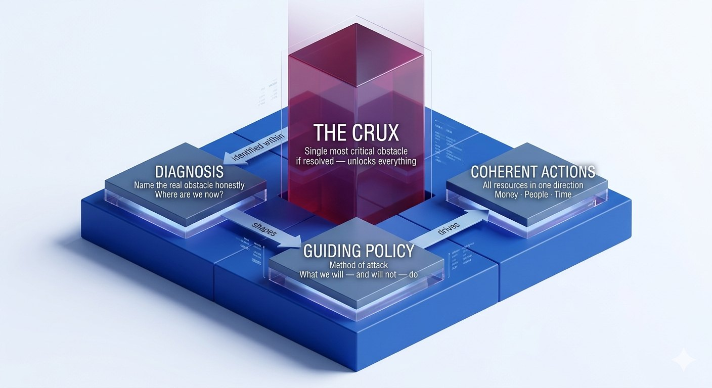
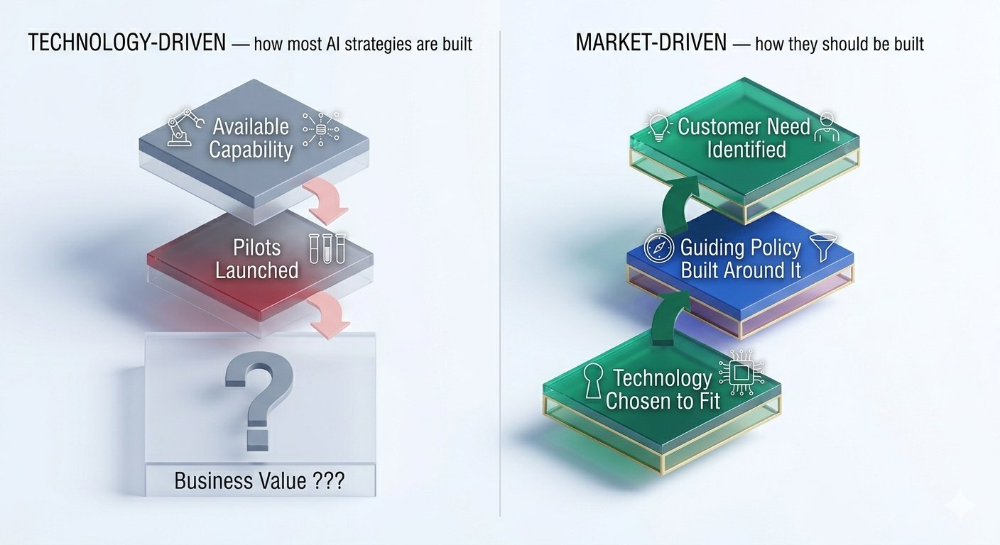
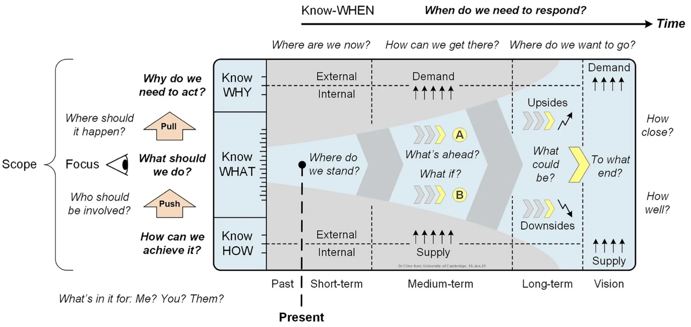
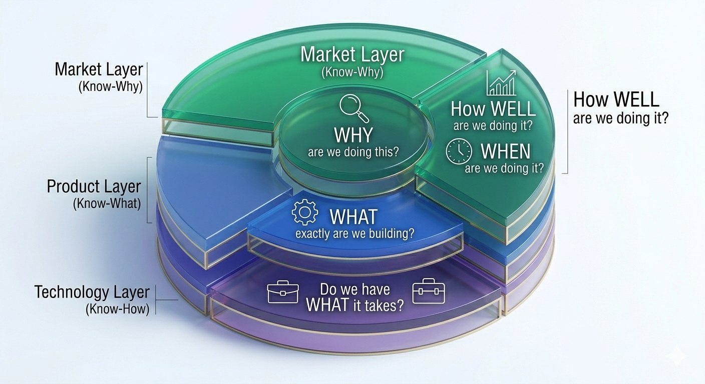

AI investment is surging, driven by board mandates, competitive fear, and the pressure of not being left behind. Most organisations have very little to show for it. The pattern is familiar: a board asks for “an AI initiative,” a chatbot gets deployed, a launch gets celebrated, and the result gets called transformation.

The problem is not a lack of ambition. It is a confusion between *wanting* something and knowing *how* to get it. For example, “We will grow AI-driven revenue by 30%” is not a strategy. It is a goal. And when organisations commit technology budgets on the basis of a goal dressed up as strategy, they are not investing. They are hoping.

There is a framework that explains exactly why and what to do instead. Chapter 5 of Richard Rumelt’s *Good Strategy / Bad Strategy* [\[1\]](#ref-Rumelt2011) gets to the heart of this. Rumelt argues that a real strategy is a tool for overcoming obstacles, not a vision statement, not a goal, not a budget. He calls the structure behind it the **strategic kernel**. It has three elements that must work together: a **diagnosis** that names the real obstacle honestly, a **guiding policy** that decides how to attack it, and **coherent actions** that align every resource (money, people, time) in the same direction, as illustrated in [Figure 1](#fig-kernel).



Figure 1: Rumelt’s Strategic Kernel — Diagnosis, Guiding Policy, and Coherent Actions anchored by the Crux

The kernel gives you the structure. But in *The Crux* [\[2\]](#ref-Rumelt2022), Rumelt adds a sharper demand: within your diagnosis, you must identify the **crux**, the one obstacle that, if removed, unlocks everything else. Most organisations sense where it lies. They just choose not to go there. Instead, they build strategy *around* it while the real obstacle sits untouched. In AI, the crux is rarely the model. It is the data quality the model cannot overcome, the decision rights no one wants to negotiate, or the workflow the technology has no way to integrate into.

Sometimes it is more fundamental still: the target itself is wrong. This happens in a recognisable pattern. Stakeholders frame problems as solutions: “we need a forecast model” rather than “we cannot meet demand”, and the actual obstacle never gets named. Technical teams, under pressure to deliver, do not push back on the problem statement. And organisations confuse *using* AI with *solving problems* with AI.

The result is a well-executed project aimed at the wrong thing: the model works, the metric it was built to move improves, and the business problem remains untouched.

> **NOTE:**
>
> **Example:** A retailer commissions a demand forecasting model to reduce stockouts. The model reaches strong accuracy. Stockouts persist. The actual constraint was that the distribution centre could not process replenishment orders any faster regardless of how early they were placed. The bottleneck was operational capacity, not forecast accuracy. No one asked whether a better forecast would change anything downstream before the project began.

Data quality, decision rights, workflow friction, wrong target: each is diagnosable before a line of code is written. Each is consistently avoided.

Nowhere is this more visible than in enterprise AI. Despite unprecedented investment, 80% of organisations are running pilots, yet only 5% have extracted measurable value [\[3\]](#ref-Joshi2026), [\[4\]](#ref-MLQ2025). That gap is not a technology failure. It is a strategy failure. No honest diagnosis, no real guiding policy, just a list of initiatives dressed up as direction. Without the kernel, the crux goes unfound. The result is not merely effort pointed at the wrong problem. It is effort not pointed at anything at all.

What makes AI a particularly acute case is not a competence failure or an ambition failure. It is that AI has structural properties that actively resist each element of the kernel in ways that cloud adoption, ERP, or even the early internet did not. Understanding those properties, explored in the next section, is what separates a framework that produces a coherent AI strategy from one that merely looks like one.

The answer is **technology roadmapping**. A roadmap is not a project plan or a feature backlog. It is a structured framework that aligns market needs, business objectives, and technology capabilities across time [\[5\]](#ref-Phaal2004). As a strategic instrument, it forces the hard questions: why are we doing this, what are we building, and do we have what it takes [\[6\]](#ref-Phaal2010)? When built around the kernel, it becomes the mechanism that translates diagnosis into direction and direction into coherent action.

This post, the first of two, explores how combining Rumelt’s strategic kernel with a structured technology roadmapping process [\[7\]](#ref-Komssi2013), [\[8\]](#ref-o2021agile) can close that gap by giving organisations the tools to find the crux, build a guiding policy around it, and take actions that are genuinely coherent rather than merely busy. The second part puts the framework into practice with a five-step AI roadmapping process and a guide to spotting bad AI strategy before it costs you.

### Why AI Is Not Just Another Technology Initiative

Before reaching for any framework, it is worth being precise about what makes AI harder to strategise around than previous technology waves. The failure rate is not simply bad strategy. It comes from AI having three properties that resist the approaches that worked for cloud, ERP, or the early internet.

**The diagnosis problem is inverted.** With most technologies, organisations identify a problem first and then evaluate whether a technology can solve it. With AI, a capability appears, such as a language model, computer vision API, or predictive platform, and the organisation searches for a problem it might solve. This is rational given AI’s novelty, but it means the crux, the real obstacle, is rarely identified. Often the problem is misframed. A demand forecast gets built because someone said “we lack accuracy,” when the real obstacle was that the sales team never acted on forecasts. The model is not wrong. The target was.

**The guiding policy has a shorter half-life.** Conventional technology strategy works because capabilities change slowly. AI breaks this. The capability frontier moves faster than planning cycles, creating what [\[9\]](#ref-Mollick2024) calls the “jagged frontier.” A policy calibrated to LLMs in 2022 was already wrong by 2024. Helmer’s [\[10\]](#ref-Helmer2016) **Counter-Positioning** explains why incumbents often cannot adopt superior AI without undermining existing investments. Inaction becomes rational precisely when the policy most needs to change. Roadmaps built on three to five year horizons are planning with assumptions that will not hold.

**Value is indirect, emergent, and hard to attribute.** Conventional enterprise technology allows a cost model to be measured upfront. AI does not [\[11\]](#ref-Iansiti2020). Helmer’s [\[10\]](#ref-Helmer2016) concepts of **Process Power** and **Scale Economies** show why. Advantage builds through proprietary feedback loops and data, not deployment. Competitors starting later begin from scratch. Value grows through use.

> **NOTE:**
>
> **Example:** A bank deploys AI for credit underwriting. In year one, analysts process applications faster, but headcount stays the same and productivity gains are hard to measure. In year two, default rates fall subtly across thousands of decisions. By year three, the model identifies a reliable segment of small business owners, enabling a new product line. Each outcome is real, but none could have been predicted in the original business case.

Measuring AI by deployed models or completed pilots is misleading. Emergent value is often hidden, causing organisations to either declare success on activity rather than outcomes or abandon quietly working initiatives.

These three properties do not make AI unstrategisable. They demand a framework designed to handle them. The diagnosis process must uncover the crux even if it is obscured. The guiding policy must be built to be revised. The performance layer must accommodate ambiguity without collapsing into vanity metrics. Combining Rumelt’s strategic kernel with a structured technology roadmapping process makes this possible, but only if the framework is applied with these failure modes in mind.

### Why Most AI Roadmaps Fail and What the Kernel Changes

Each of those three structural properties has a direct expression in how AI roadmaps are typically built and why they fail. Most fail before the first slide is drawn. The failure is not in the execution. It is in where the process starts.

IBM reports that 64% of CEOs admit to investing in technology before fully understanding its potential impact [\[12\]](#ref-IBM2025). There are two ways this goes wrong. The first is a *technology-driven* strategy: starting with available capabilities and working backwards, hoping a business case materialises. The second, less obvious failure is waiting for perfect market insight before engaging with the technology at all. In AI, neither extreme works. The roadmapping literature points to a more disciplined path: one that starts with a real, felt problem, uses technology awareness to sharpen the diagnosis, and then asks what capabilities are genuinely required to solve it [\[13\]](#ref-Vishnevskiy2016), [\[14\]](#ref-Noh2021), as shown in [Figure 2](#fig-tech-vs-market).



Figure 2: Technology-Driven vs Market-Driven AI Strategy — starting from capability alone, without a diagnosed problem, is where most AI investments lose their way

To correct this, organisations need a roadmap that starts with a real problem not with an available capability. In AI, this does not mean ignoring what the technology makes possible. It means using that awareness as an input to diagnosis, not as a substitute for it. According to [\[6\]](#ref-Phaal2010), a roadmap only becomes truly strategic when it honestly addresses five questions: **Why, What, How, When, and How Well**. Without all five, you do not have a strategy. You have a to-do list with a Gantt chart attached, as shown in [Figure 3](#fig-roadmap-gov).



Figure 3: Roadmapping Governing Framework: Integrating the ‘Know’ Layers and Strategic Questions

What makes this combination powerful is how naturally Rumelt’s three kernel elements map onto the roadmapping questions that [\[15\]](#ref-Kerr2022) identifies: *Where are we now? Where do we want to go? How can we get there?* and onto the knowledge layers that [\[5\]](#ref-Phaal2004) describes. Rather than two separate frameworks running in parallel, they function as three lenses on the same strategic problem, each reinforcing the other, as shown in [Table 1](#tbl-kernel-map).

| Rumelt’s Kernel | Roadmapping Question | Roadmap Layer | Strategic Focus |
|:---|:---|:---|:---|
| **Diagnosis** | Where are we now? | **Know-Why** | Market trends, value gaps, and identifying the “Crux” |
| **Guiding Policy** | Where do we want to go? | **Know-What** | Strategic intent, AI offerings, and business alignment |
| **Coherent Actions** | How can we get there? | **Know-How** | Skills, capabilities, and execution |
| **Coherent Actions** | When and how well? | **Know-When / How Well** | Timelines, milestones, performance metrics, and continuous review |

Table 1: **Integration of Rumelt’s Kernel and Roadmapping Layers**

That mapping matters because it is not arbitrary. Each row in the table is a direct response to one of the three structural AI challenges described earlier. The **Diagnosis / Know-Why** layer confronts the inverted diagnosis problem: by anchoring the process in market trends and value gaps, it forces the question of what problem actually needs solving before any capability is selected. The **Guiding Policy / Know-What** layer addresses policy decay: rather than a fixed strategic intent, it is designed to be revisited as the capability frontier shifts. The **Coherent Actions / Know-When / How Well** layer addresses emergent value: it replaces activity metrics with outcome-linked milestones that can hold ambiguity without collapsing into vanity measures.

The real value of strategic roadmapping is not the diagram you produce. It is the disciplined thinking the process forces you to do. When built around the kernel [\[5\]](#ref-Phaal2004), [\[7\]](#ref-Komssi2013), the crux drives resource allocation rather than enthusiasm. The guiding policy is built to be revised as the capability frontier shifts, not locked in with assumptions that will not hold. Coherent actions replace scattered pilots, each tied to a specific measurable question, making emergent value visible rather than declared. And the roadmap makes the kernel visible across diverse teams, not just in the strategy document, but in the work.

The layered nature of this framework (Market, Product, and Technology working together) is shown in [Figure 4](#fig-kernel-strategy).



Figure 4: The layered roadmapping framework — Market (Know-Why), Product (Know-What), and Technology (Know-How) working together

The question is no longer whether to build a roadmap. It is whether to build one that actually works.

### Conclusion: The Kernel is the Roadmap, the Roadmap is the Kernel

AI is not simply a hard technology to deploy. It is a technology that structurally resists the strategy discipline that worked for every previous enterprise technology wave. It inverts the normal diagnostic sequence, shortens the useful life of any guiding policy, and produces value in forms that conventional measurement instruments cannot capture. These are not execution problems. They are design problems and they require a framework that is built with them in view.

That is what combining Rumelt’s kernel with a structured technology roadmap provides. The kernel supplies the architecture: a diagnosis that names the real obstacle, a guiding policy built to be revised rather than fixed, and coherent actions measured by outcomes rather than activity. The roadmap supplies the operational mechanism: a structured process that forces the five strategic questions, Why, What, How, When, and How Well, and makes the kernel visible across the organisation, not just in the strategy document.

The gap between 80% running pilots and 5% extracting value is not a technology gap. It is a strategy gap created by frameworks that were not designed for AI’s structural properties. And it is closeable, but only if the framework is.

The next post puts this framework into practice: a five-step AI roadmapping process, real case studies of failure, and a practical guide to spotting bad AI strategy before it costs you.

## References

\[1\]

R. P. Rumelt, *Good strategy/bad strategy: The difference and why it matters*. New York, NY: Crown Business, 2011.

\[2\]

R. P. Rumelt, *The crux: High-stakes problems and the art of strategy*. New York, NY: PublicAffairs, 2022.

\[3\]

M. Joshi, “Most AI strategies don’t fail on vision – they fail on execution design.” \[Online\]. Available: <https://www.raconteur.net/technology/ai-failure-is-rarely-ambition-or-funding-its-execution-design>

\[4\]

MIT Project NANDA, “The GenAI divide: State of AI in business 2025,” Massachusetts Institute of Technology, 2025. Available: <https://mlq.ai/media/quarterly_decks/v0.1_State_of_AI_in_Business_2025_Report.pdf>

\[5\]

R. Phaal, C. J. P. Farrukh, and D. Probert, “Technology roadmapping – A planning framework for evolution and revolution,” *Technological Forecasting and Social Change*, vol. 71, pp. 5–26, 2004, doi: [10.1016/S0040-1625(03)00072-6](https://doi.org/10.1016/S0040-1625(03)00072-6).

\[6\]

R. Phaal, C. J. P. Farrukh, and D. R. Probert, *Roadmapping for strategy and innovation: Aligning technology and markets in a dynamic world*. Cambridge, UK: University of Cambridge, Institute for Manufacturing, 2010.

\[7\]

M. Komssi, M. Kauppinen, H. Töhönen, L. Lehtola, and A. M. Davis, “Roadmapping problems in practice: Value creation from the perspective of the customers,” *Requirements Engineering*, vol. 20, no. 1, 2013, doi: [10.1007/s00766-013-0186-3](https://doi.org/10.1007/s00766-013-0186-3).

\[8\]

E. O’Sullivan, R. Phaal, and Ch. Featherston, “Agile roadmapping: An adaptive approach to technology foresight,” *Foresight and STI Governance*, vol. 15, no. 2, pp. 65–81, 2021, doi: [10.17323/2500-2597.2021.2.65.81](https://doi.org/10.17323/2500-2597.2021.2.65.81).

\[9\]

E. Mollick, *Co-intelligence: Living and working with AI*. New York, NY: Portfolio/Penguin, 2024.

\[10\]

H. Helmer, *7 powers: The foundations of business strategy*. Deep Strategy LLC, 2016.

\[11\]

M. Iansiti and K. R. Lakhani, *Competing in the age of AI: Strategy and leadership when algorithms and networks run the world*. Boston, MA: Harvard Business Review Press, 2020.

\[12\]

IBM Institute for Business Value, “CEO study 2025: The transformative CEO,” IBM, 2025. Available: <https://www.ibm.com/thought-leadership/institute-business-value/en-us/c-suite-study/ceo>

\[13\]

K. Vishnevskiy, O. Karasev, and D. Meissner, “Integrated roadmaps for strategic management and planning,” *Technological Forecasting and Social Change*, vol. 110, pp. 153–166, 2016, doi: [10.1016/j.techfore.2015.10.020](https://doi.org/10.1016/j.techfore.2015.10.020).

\[14\]

H. Noh, Y. Song, and S. Lee, “Technology roadmapping for R&D planning and the development of emerging fields,” *Journal of Engineering and Technology Management*, vol. 62, p. 101650, 2021, doi: [10.1016/j.jengtecman.2021.101650](https://doi.org/10.1016/j.jengtecman.2021.101650).

\[15\]

C. Kerr and R. Phaal, “Roadmapping and roadmaps: Definition and underpinning concepts,” *IEEE Transactions on Engineering Management*, vol. 69, no. 1, pp. 6–16, 2022, doi: [10.1109/TEM.2021.3096012](https://doi.org/10.1109/TEM.2021.3096012).

## Citation

BibTeX citation:

``` quarto-appendix-bibtex
@online{faustine2026,
  author = {Faustine, Anthony},
  title = {The {Strategic} {Kernel} and the {AI} {Strategy} {Gap}},
  date = {2026-03-28},
  url = {https://sambaiga.github.io/pages/blog/posts/2026/03/},
  langid = {en}
}
```
