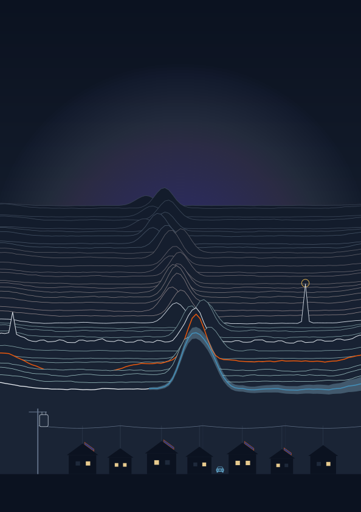

::: {.lead}
A structured path from the smart-meter signal to decisions on the low-voltage distribution network. Each chapter pairs a narrative page with a companion notebook, so that every figure and table in the text can be reproduced.
:::

[Read online](https://sambaiga.github.io/mbuga/){.btn .btn-primary .btn-sm} [Companion repository](https://github.com/sambaiga/mbuga){.btn .btn-outline-secondary .btn-sm}

## What the book covers

A smart meter reports one number at regular intervals, and almost everything of interest to a distribution network operator lies in what that number implies. The book follows the signal to the decisions it supports: which customers behave alike and where the network is at risk, which connection requests and mitigation measures to recommend, and which readings are abnormal. Each concept is taught formally, with its assumptions, alternatives and failure modes, and then applied to a low-voltage problem on metered households.

## Parts and chapters

The web edition grows chapter by chapter, as each is written, run and reviewed.

**Part 5. Clustering**

1. Clustering Load Profiles
2. Validating Clusters
3. Clustering Metered Households
4. Network Risk
5. Customers and Connections

**Part 6. Retrieval, Ranking and Recommendation**

1. Foundations of Retrieval, Ranking and Recommendation
2. Retrieval for Connection Requests
3. Ranking Transformers and Violations
4. Recommending Mitigation Measures

**Part 7. Anomaly Detection**

1. Foundations of Anomaly Detection
2. Meter Data Quality and Customer Behaviour
3. Non-Technical Loss and Changes over Time

## Built on open-source libraries

The methods are implemented in libraries that can be installed and reused outside the book.

| Library | Role in the book |
|---|---|
| [Milia](https://pypi.org/project/pundamilia/) | Clustering of load profiles, retrieval of similar cases and anomaly detection |
| [Popo](https://pypi.org/project/popo-flow/) | Low-voltage power flow and state estimation for network studies |
| [Twiga](https://pypi.org/project/twiga/) | Point and probabilistic forecasting |

See the [Software](../software/index.html) page for installation and documentation.

## Who it is for

The book is written for energy analysts and machine learning practitioners who work with smart-meter data and need methods that hold up on real networks, and for students of distribution-network analytics.

## Status

The book is in progress. Its other titles are listed on the [Books](index.html) page.
