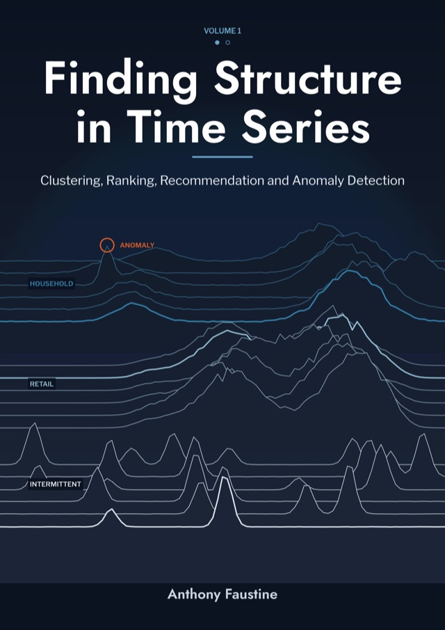
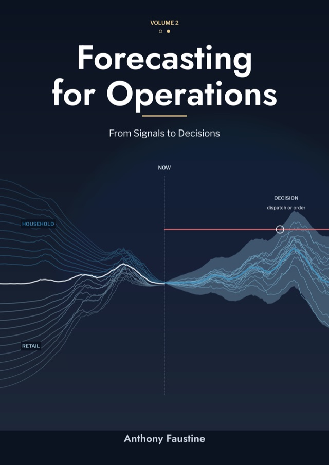
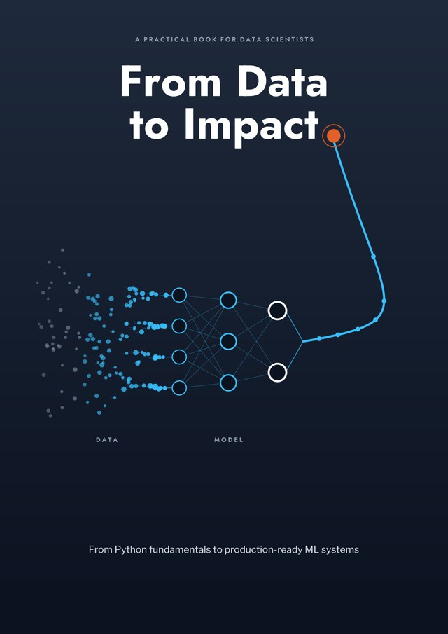

# Books

Books on machine learning for time series, data science practice and relationships. The two volumes on time series are worked on energy and supply chain data, with the code of every figure in a companion notebook.

Time series

## [Finding Structure in Time Series](https://sambaiga.github.io/mbuga/structure/)

2026

Clustering, Ranking, Recommendation and Anomaly Detection

Machine learning methods for time series, worked on energy and supply chain data, built to be run, not just read. Each chapter pairs a narrative page with a companion notebook, so that every figure and table is computed by code. Volume 1 of two.

Read more

Time Series Clustering Ranking Recommendation Anomaly Detection

In ProgressVolume 1 · 1 Part · 5 Chapters

[About the book](mbuga.llms.md#structure) [Read online](https://sambaiga.github.io/mbuga/structure/)

## [Forecasting for Operations](https://sambaiga.github.io/mbuga/operations/)

2026

From Signals to Decisions

Machine learning methods for time series, worked on energy and supply chain data: what the signals allow before a model is chosen, the families of forecasters, and how a forecast is evaluated without fooling oneself. Volume 2 of two.

Read more

Forecasting Evaluation Decisions Energy Supply Chain

In ProgressVolume 2 · 1 Part · 3 Chapters

[About the book](mbuga.llms.md#operations) [Read online](https://sambaiga.github.io/mbuga/operations/)

Data science

## [From Data to Impact](https://sambaiga.github.io/ds-mlops-path/)

2026

A Structured Path from Python Fundamentals to Production-Ready Data Science

A structured, project-based path from Python fundamentals to production-ready data science and MLOps, built to be run and not just read. Ten parts across more than 20 chapters, from Python core and NumPy through classical ML, deep learning, LLMs and MLOps deployment.

Read more

Python Machine Learning MLOps Deep Learning Data Science

In Progress10 Parts · 20+ Chapters

[Read online](https://sambaiga.github.io/ds-mlops-path/)

Relationships

## [Love That Lasts](https://sambaiga.github.io/love-that-lasts/)

2026

A 4-Day Guide for Couples Integrating Faith, Personality, and Emotional Intelligence

A self-guided four-day course in which couples move from experiencing love to practising it. It combines biblical foundations, the Big Five personality framework and emotional intelligence, with 20 to 30 minutes of work per day.

Read more

Relationships Faith Emotional Intelligence Personality

Available4 Days · Self-guided

[Read online](https://sambaiga.github.io/love-that-lasts/)
