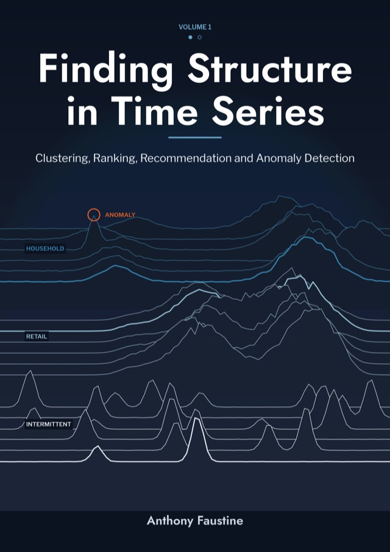
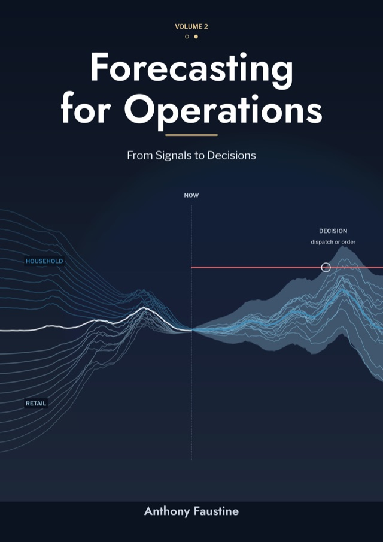

# Machine Learning Methods for Time Series

Machine learning methods for time series, worked on energy and supply chain data, in two books. Each chapter pairs a narrative page with a companion notebook, so that every figure and table in the text is computed by code that the reader can run.

[Read Volume 1 online](https://sambaiga.github.io/mbuga/structure/) [Read Volume 2 online](https://sambaiga.github.io/mbuga/operations/) [Both books](https://sambaiga.github.io/mbuga/)

## Volume 1. Finding Structure in Time Series

**Clustering, Ranking, Recommendation and Anomaly Detection.** The first volume shows how to find structure in many time series at once: which series behave alike, which ones deserve attention first, which cases are similar to a new one, and which observations do not belong. The worked examples follow the smart-meter signal to decisions on the low-voltage distribution network.

[Read Volume 1 online](https://sambaiga.github.io/mbuga/structure/)

**Part 5. Clustering**

1.  Clustering Load Profiles
2.  Validating Clusters
3.  Clustering Metered Households
4.  Network Risk
5.  Customers and Connections

Further parts, on retrieval, ranking and recommendation and on anomaly detection, are added to the web edition as they are reviewed.

## Volume 2. Forecasting for Operations

**From Signals to Decisions.** The second volume covers what the signals allow before a model is chosen, the families of forecasters, and how a forecast is evaluated without fooling oneself.

[Read Volume 2 online](https://sambaiga.github.io/mbuga/operations/)

**Part 8. Forecasting**

1.  Forecasting for Decisions
2.  Characterising Series and Selecting Inputs
3.  Forecasters and Their Evaluation

The web editions grow chapter by chapter, as each is written, run and reviewed.

## Built on open-source libraries

The methods are implemented in libraries that can be installed and reused outside the books.

| Library | Role in the books |
|----|----|
| [Milia](https://pypi.org/project/pundamilia/) | Clustering of load profiles, retrieval of similar cases and anomaly detection |
| [Popo](https://pypi.org/project/popo-flow/) | Low-voltage power flow and state estimation for network studies |
| [Twiga](https://pypi.org/project/twiga/) | Point and probabilistic forecasting |

See the [Software](../software/index.llms.md) page for installation and documentation.

## Status

Both volumes are in progress. The other titles are listed on the [Books](index.llms.md) page.
