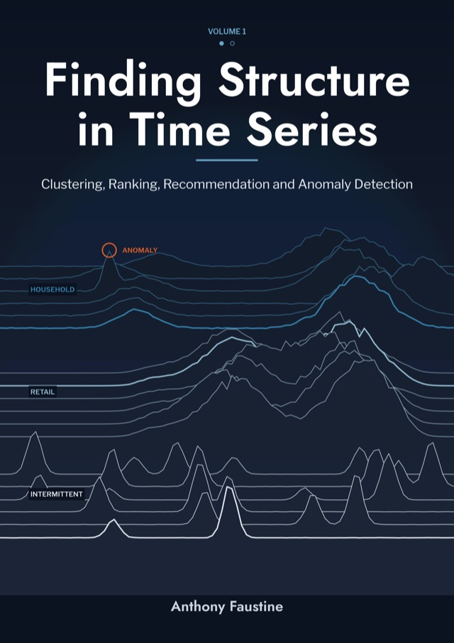
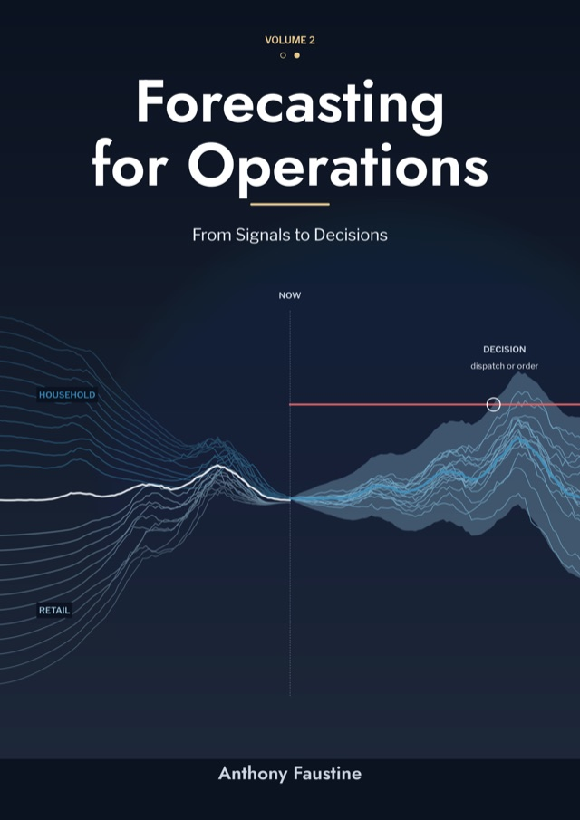

::: {.lead}
Machine learning methods for time series, worked on energy and supply chain data, in two books. Each chapter pairs a narrative page with a companion notebook, so that every figure and table in the text is computed by code that the reader can run.
:::

[Read Volume 1 online](https://sambaiga.github.io/mbuga/structure/){.btn .btn-primary .btn-sm} [Read Volume 2 online](https://sambaiga.github.io/mbuga/operations/){.btn .btn-primary .btn-sm} [Both books](https://sambaiga.github.io/mbuga/){.btn .btn-outline-secondary .btn-sm}

## Volume 1. Finding Structure in Time Series {#structure}

**Clustering, Ranking, Recommendation and Anomaly Detection.** The first volume shows how to find structure in many time series at once: which series behave alike, which ones deserve attention first, which cases are similar to a new one, and which observations do not belong. The worked examples follow the smart-meter signal to decisions on the low-voltage distribution network.

[Read Volume 1 online](https://sambaiga.github.io/mbuga/structure/){.btn .btn-outline-primary .btn-sm}

**Part 5. Clustering**

1. Clustering Load Profiles
2. Validating Clusters
3. Clustering Metered Households
4. Network Risk
5. Customers and Connections

**Part 6. Retrieval, Ranking and Recommendation**

1. Foundations of Retrieval, Ranking and Recommendation
2. Retrieval for Connection Requests
3. Ranking Transformers and Violations
4. Recommending Mitigation Measures

**Part 7. Anomaly Detection**

1. Foundations of Anomaly Detection
2. Meter Data Quality and Customer Behaviour
3. Non-Technical Loss and Changes over Time

## Volume 2. Forecasting for Operations {#operations}

**From Signals to Decisions.** The second volume covers what the signals allow before a model is chosen, the families of forecasters, and how a forecast is evaluated without fooling oneself.

[Read Volume 2 online](https://sambaiga.github.io/mbuga/operations/){.btn .btn-outline-primary .btn-sm}

**Part 8. Forecasting**

1. Signals
2. Forecasters and Their Evaluation

The web editions grow chapter by chapter, as each is written, run and reviewed.

## Built on open-source libraries

The methods are implemented in libraries that can be installed and reused outside the books.

| Library | Role in the books |
|---|---|
| [Milia](https://pypi.org/project/pundamilia/) | Clustering of load profiles, retrieval of similar cases and anomaly detection |
| [Popo](https://pypi.org/project/popo-flow/) | Low-voltage power flow and state estimation for network studies |
| [Twiga](https://pypi.org/project/twiga/) | Point and probabilistic forecasting |

See the [Software](../software/index.html) page for installation and documentation.

## Status

Both volumes are in progress. The other titles are listed on the [Books](index.html) page.
