# Research

20 papers · 14 journal articles · 6 conference papers

## Research focus

My research develops methods and approaches for time series analysis and forecasting, mostly for power systems, from non-intrusive load monitoring to probabilistic net-load forecasting for low-voltage networks. In my current work at Analog Devices I develop demand forecasting methods for the semiconductor supply chain, and I am interested in innovation and technology management.

[All 20](#) [NILM 10](#) [Forecasting 4](#) [Sensing and networks 3](#) [Innovation and technology management 2](#) [Energy systems 1](#)

[All types](#) [Journal articles 14](#) [Conference papers 6](#)

Sort Newest first Oldest first Title A to Z

Show all papers

No paper matches the current filters.

JournalNILM2017

### [A Survey on Non-Intrusive Load Monitoring Methodies and Techniques for Energy Disaggregation Problem](../../pages/publication/articles/Arviz-nilm/index.llms.md)

**Anthony Faustine**, Nerey Henry Mvungi, Shubi Kaijage and Kisangiri Michael

CoRR

Abstract

[Link](https://arxiv.org/abs/1703.00785)

Cite

@article{faustine2017survey, title = {{A Survey on Non-Intrusive Load Monitoring Methodies and Techniques for Energy Disaggregation Problem}}, author = {Faustine, Anthony and Mvungi, Nerey Henry and Kaijage, Shubi and Michael, Kisangiri}, journal = {CoRR}, year = {2017}, volume = {abs/1703.00785} } Anthony Faustine, Nerey Henry Mvungi, Shubi Kaijage and Kisangiri Michael (2017). A Survey on Non-Intrusive Load Monitoring Methodies and Techniques for Energy Disaggregation Problem. CoRR. The rapid urbanization of developing countries coupled with explosion in construction of high rising buildings and the high power usage in them calls for conservation and efficient energy program. Such a program require monitoring of end-use appliances energy consumption in real-time. The worldwide recent adoption of smart-meter in smart-grid, has led to the rise of Non-Intrusive Load Monitoring (NILM); which enables estimation of appliance-specific power consumption from building's aggregate power consumption reading. NILM provides households with cost-effective real-time monitoring of end-use appliances to help them understand their consumption pattern and become part and parcel of energy conservation strategy. This paper presents an up to date overview of NILM system and its associated methods and techniques for energy disaggregation problem. This is followed by the review of the state-of-the art NILM algorithms. Furthermore, we review several performance metrics used by NILM researcher to evaluate NILM algorithms and discuss existing benchmarking framework for direct comparison of the state of the art NILM algorithms. Finally, the paper discuss potential NILM use-cases, presents an overview of the public available dataset and highlight challenges and future research directions.

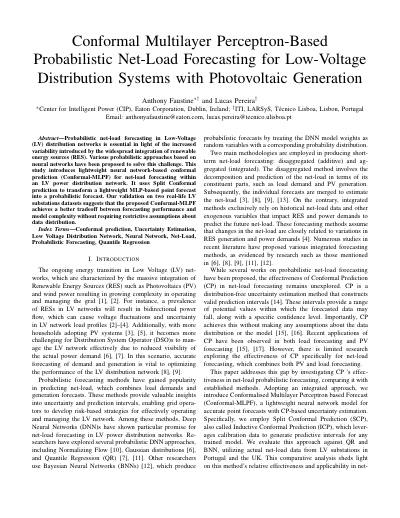

ConferenceForecasting2024

### [Conformal Multilayer Perceptron-Based Probabilistic Net-Load Forecasting for Low-Voltage Distribution Systems with Photovoltaic Generation](../../pages/publication/conferences/smartgrid-2024/index.llms.md)

**Anthony Faustine** and Pereira, Lucas

2024 IEEE International Conference on Communications, Control, and Computing Technologies for Smart Grids (SmartGridComm), Oslo, Norway

Abstract

[Slide](../../files/slides/Oslo_cinference_2024.pdf) [Link](https://ieeexplore.ieee.org/document/10738106) [DOI](https://doi.org/10.1109/smartgridcomm60555.2024.10738106) [Talk](../talks/smartgridcomm-2024/index.llms.md)

Cite

[PDF](../../files/papers/ConformalMLPF.pdf)

@inproceedings{faustine2024conformal, title = {{Conformal Multilayer Perceptron-Based Probabilistic Net-Load Forecasting for Low-Voltage Distribution Systems with Photovoltaic Generation}}, author = {Faustine, Anthony and Pereira, Lucas}, booktitle = {2024 IEEE International Conference on Communications, Control, and Computing Technologies for Smart Grids (SmartGridComm)}, year = {2024}, pages = {59--64}, doi = {10.1109/smartgridcomm60555.2024.10738106} } Anthony Faustine and Pereira, Lucas (2024). Conformal Multilayer Perceptron-Based Probabilistic Net-Load Forecasting for Low-Voltage Distribution Systems with Photovoltaic Generation. 2024 IEEE International Conference on Communications, Control, and Computing Technologies for Smart Grids (SmartGridComm), Oslo, Norway. This paper presents a probabilistic forecasting approach tailored for low voltage (LV) substations, offering short-term predictions for three crucial variables: voltage, reactive power, and active power. These parameters play a vital role in the resilience of distribution systems, especially in the presence of Distributed Energy Resources (DERs).

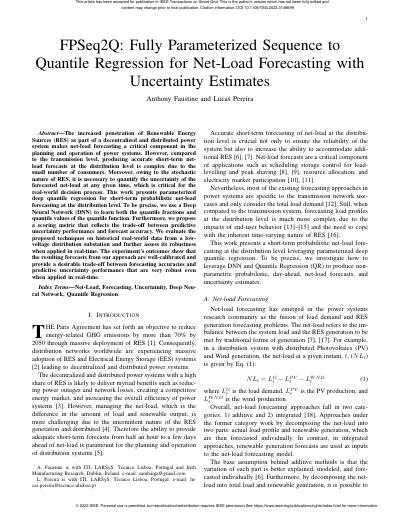

JournalForecasting2022

### [FPSeq2Q: Fully Parameterized Sequence to Quantile Regression for Net-Load Forecasting With Uncertainty Estimates](../../pages/publication/articles/fqr-2024/index.llms.md)

**Anthony Faustine** and Pereira, Lucas

IEEE Transactions on Smart Grid, Vol. 13, No. 3, pp. 2440-2451

Abstract

[Link](https://ieeexplore.ieee.org/document/9701598) [Code](https://github.com/sambaiga/FPSeq2Q) [DOI](https://doi.org/10.1109/tsg.2022.3148699)

Cite

[PDF](../../files/papers/FPSeq2Q.pdf)

@article{faustine2022fpseq2q, title = {{FPSeq2Q: Fully Parameterized Sequence to Quantile Regression for Net-Load Forecasting With Uncertainty Estimates}}, author = {Faustine, Anthony and Pereira, Lucas}, journal = {IEEE Transactions on Smart Grid}, year = {2022}, volume = {13}, number = {3}, pages = {2440--2451}, doi = {10.1109/tsg.2022.3148699} } Anthony Faustine and Pereira, Lucas (2022). FPSeq2Q: Fully Parameterized Sequence to Quantile Regression for Net-Load Forecasting With Uncertainty Estimates. IEEE Transactions on Smart Grid, Vol. 13, No. 3, pp. 2440-2451. The increased penetration of Renewable Energy Sources (RES) as part of a decentralized and distributed power system makes net-load forecasting a critical component in the planning and operation of power systems. However, compared to the transmission level, producing accurate short-term net-load forecasts at the distribution level is complex due to the small number of consumers. Moreover, owing to the stochastic nature of RES, it is necessary to quantify the uncertainty of the forecasted net-load at any given time, which is critical for the real-world decision process. This work presents parameterized deep quantile regression for short-term probabilistic net-load forecasting at the distribution level. To be precise, we use a Deep Neural Network (DNN) to learn both the quantile fractions and quantile values of the quantile function. Furthermore, we propose a scoring metric that reflects the trade-off between predictive uncertainty performance and forecast accuracy. We evaluate the proposed techniques on historical real-world data from a low-voltage distribution substation and further assess its robustness when applied in real-time. The experiment’s outcomes show that the resulting forecasts from our approach are well-calibrated and provide a desirable trade-off between forecasting accuracies and predictive uncertainty performance that are very robust even when applied in real-time.

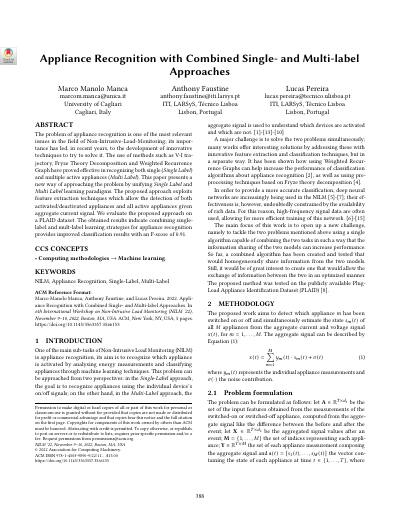

ConferenceNILM2022

### [Appliance recognition with combined single- and multi-label approaches](../../pages/publication/conferences/buildsys-2022/index.llms.md)

Manca, Matteo and **Anthony Faustine** and Pereira, Lucas

7th International Workshop on Non-Intrusive Appliance Load Monitoring (NILM@BuildSys 2022), Boston, MA, USA

Abstract

[Link](https://dl.acm.org/doi/10.1145/3563357.3566153) [DOI](https://doi.org/10.1145/3563357.3566153)

Cite

@inproceedings{manca2022appliance, title = {{Appliance recognition with combined single- and multi-label approaches}}, author = {Manca, Marco Manolo and Faustine, Anthony and Pereira, Lucas}, booktitle = {Proceedings of the 9th ACM International Conference on Systems for Energy-Efficient Buildings, Cities, and Transportation}, year = {2022}, pages = {388--392}, doi = {10.1145/3563357.3566153} } Manca, Matteo and Anthony Faustine and Pereira, Lucas (2022). Appliance recognition with combined single- and multi-label approaches. 7th International Workshop on Non-Intrusive Appliance Load Monitoring (NILM@BuildSys 2022), Boston, MA, USA. Appliance recognition in non-intrusive load monitoring (NILM) is typically framed as either a single-label or multi-label classification problem. Single-label approaches predict one appliance per activation event, while multi-label approaches predict the set of simultaneously active appliances. Both paradigms have complementary strengths: single-label methods excel at isolating dominant loads with clear event signatures, whereas multi-label methods handle concurrent appliance operation. This paper proposes a combined approach that leverages both paradigms within a unified recognition pipeline. We train a single-label classifier for isolated events and a multi-label classifier for overlapping load periods, then fuse their outputs via a learned gating mechanism. Evaluation on the UK-DALE dataset shows that the combined approach outperforms either method in isolation, achieving higher F1 scores across all evaluated appliances.

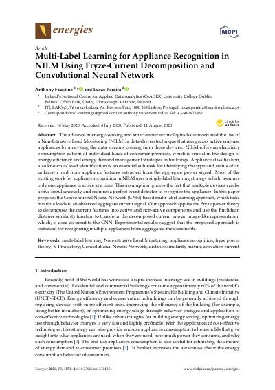

JournalNILM2020

### [Multi-Label Learning for Appliance Recognition in NILM Using Fryze-Current Decomposition and Convolutional Neural Network](../../pages/publication/articles/MLABELILM/index.llms.md)

**Anthony Faustine** and Pereira, Lucas

Energies, Vol. 13, No. 16, pp. 1996-1073

Abstract

[Link](https://www.mdpi.com/1996-1073/13/16/4154) [Code](https://github.com/sambaiga/MLCFCD) [DOI](https://doi.org/10.3390/en13164154)

Cite

[PDF](../../files/papers/mlabelvi.pdf)

@article{faustine2020multi, title = {{Multi-Label Learning for Appliance Recognition in NILM Using Fryze-Current Decomposition and Convolutional Neural Network}}, author = {Faustine, Anthony and Pereira, Lucas}, journal = {Energies}, year = {2020}, volume = {13}, number = {16}, pages = {4154}, doi = {10.3390/en13164154} } Anthony Faustine and Pereira, Lucas (2020). Multi-Label Learning for Appliance Recognition in NILM Using Fryze-Current Decomposition and Convolutional Neural Network. Energies, Vol. 13, No. 16, pp. 1996-1073. The advance in energy-sensing and smart-meter technologies have motivated the use of a Non-Intrusive Load Monitoring (NILM), a data-driven technique that recognizes active end-use appliances by analyzing the data streams coming from these devices. NILM offers an electricity consumption pattern of individual loads at consumer premises, which is crucial in the design of energy efficiency and energy demand management strategies in buildings. Appliance classification, also known as load identification is an essential sub-task for identifying the type and status of an unknown load from appliance features extracted from the aggregate power signal. Most of the existing work for appliance recognition in NILM uses a single-label learning strategy which, assumes only one appliance is active at a time. This assumption ignores the fact that multiple devices can be active simultaneously and requires a perfect event detector to recognize the appliance. In this paper proposes the Convolutional Neural Network (CNN)-based multi-label learning approach, which links multiple loads to an observed aggregate current signal. Our approach applies the Fryze power theory to decompose the current features into active and non-active components and use the Euclidean distance similarity function to transform the decomposed current into an image-like representation which, is used as input to the CNN. Experimental results suggest that the proposed approach is sufficient for recognizing multiple appliances from aggregated measurements.

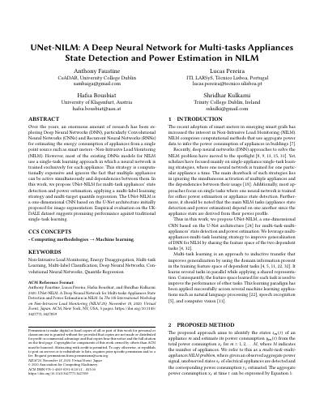

ConferenceNILM2020

### [UNet-NILM: A deep neural network for multi-tasks appliances state detection and power estimation in NILM](../../pages/publication/conferences/unet-nilm-2020/index.llms.md)

**Anthony Faustine** and Pereira, Lucas and Bousbiat, Hafsa and Kulkarni, Shridhar

5th International Workshop on Non-Intrusive Appliance Load Monitoring (NILM), BuildSys 2020, Virtual

Abstract

[Link](https://dl.acm.org/doi/10.1145/3427771.3427859) [Code](https://github.com/sambaiga/UNETNiLM) [DOI](https://doi.org/10.1145/3427771.3427859) [Talk](../talks/unet-nilm-2020/index.llms.md)

Cite

[PDF](../../files/papers/inilm-multitask.pdf)

@inproceedings{faustine2020unetnilm, title = {{UNet-NILM: A Deep Neural Network for Multi-tasks Appliances State Detection and Power Estimation in NILM}}, author = {Faustine, Anthony and Pereira, Lucas and Bousbiat, Hafsa and Kulkarni, Shridhar}, booktitle = {Proceedings of the 5th International Workshop on Non-Intrusive Load Monitoring}, year = {2020}, pages = {84--88}, doi = {10.1145/3427771.3427859} } Anthony Faustine and Pereira, Lucas and Bousbiat, Hafsa and Kulkarni, Shridhar (2020). UNet-NILM: A deep neural network for multi-tasks appliances state detection and power estimation in NILM. 5th International Workshop on Non-Intrusive Appliance Load Monitoring (NILM), BuildSys 2020, Virtual. Non-Intrusive Load Monitoring (NILM) is the task of decomposing aggregate power consumption into individual appliance-level signals. Existing deep learning approaches for NILM typically address either appliance state detection or power estimation as separate tasks, limiting their practical utility. This paper proposes UNet-NILM, a multi-task deep neural network architecture inspired by the U-Net encoder-decoder design for semantic segmentation. UNet-NILM simultaneously detects appliance ON/OFF states and estimates per-appliance active power consumption from aggregate mains readings. We evaluate the approach on the UK-DALE and REFIT datasets across five target appliances. Results show that UNet-NILM achieves state-of-the-art performance on both tasks simultaneously, demonstrating that joint optimisation of detection and estimation objectives is mutually beneficial. The proposed architecture offers a practical step toward deployable NILM systems that provide both appliance status and fine-grained energy consumption data.

JournalInnovation and technology management2024

### [Maximising AI Value: Strategic Approaches and Practical Frameworks for Organisational Success](../../pages/publication/articles/maximising-ai-value/index.llms.md)

**Anthony Faustine**

Arrow@TU Dublin

Abstract

[Link](https://arrow.tudublin.ie/)

Cite

@article{faustine2024maximising, title = {{Maximising AI Value: Strategic Approaches and Practical Frameworks for Organisational Success}}, author = {Anthony Faustine}, journal = {Arrow@TU Dublin}, year = {2024} } Anthony Faustine (2024). Maximising AI Value: Strategic Approaches and Practical Frameworks for Organisational Success. Arrow@TU Dublin. Artificial intelligence adoption has accelerated across industries, yet many organisations struggle to translate AI investments into sustained business value. This paper identifies the strategic and organisational factors that differentiate high-value AI implementations from those that underdeliver. Drawing on practitioner frameworks and case analysis, we propose a multi-layer model for AI value creation encompassing data readiness, model governance, human-AI collaboration design, and executive alignment. We examine common failure modes — including misaligned incentives, poor problem scoping, and inadequate change management — and provide practical prescriptions for each. The resulting framework is designed to guide AI practitioners, product owners, and senior leaders in structuring AI programmes that deliver measurable organisational impact.

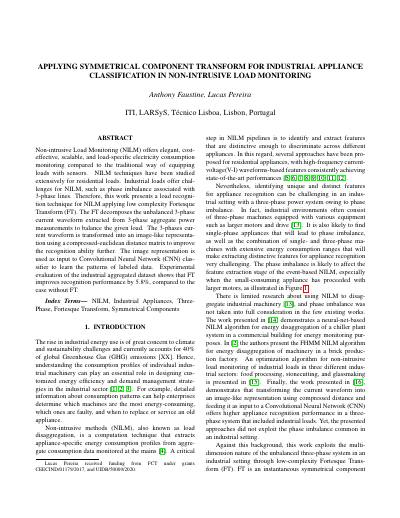

ConferenceNILM2023

### [Applying symmetrical component transform for industrial appliance classification in non-intrusive load monitoring](../../pages/publication/conferences/icassp-2023/index.llms.md)

**Anthony Faustine** and Pereira, Lucas

IEEE International Conference on Acoustics, Speech and Signal Processing (ICASSP 2023), Rhodes Island, Greece

Abstract

[Link](https://doi.org/10.1109/ICASSP49357.2023.10096324) [DOI](https://doi.org/10.1109/icassp49357.2023.10096324)

Cite

[PDF](../../files/papers/IndustrialNILM.pdf)

@inproceedings{faustine2023applying, title = {{Applying Symmetrical Component Transform for Industrial Appliance Classification in Non-Intrusive Load Monitoring}}, author = {Faustine, Anthony and Pereira, Lucas}, booktitle = {ICASSP 2023 - 2023 IEEE International Conference on Acoustics, Speech and Signal Processing (ICASSP)}, year = {2023}, pages = {1--5}, doi = {10.1109/icassp49357.2023.10096324} } Anthony Faustine and Pereira, Lucas (2023). Applying symmetrical component transform for industrial appliance classification in non-intrusive load monitoring. IEEE International Conference on Acoustics, Speech and Signal Processing (ICASSP 2023), Rhodes Island, Greece. Industrial non-intrusive load monitoring (NILM) presents unique challenges compared to residential settings, including complex three-phase power systems, diverse load types, and high measurement noise. This paper proposes applying the symmetrical component transform (SCT) — a classical power systems technique — as a feature extraction step for industrial appliance classification in NILM. The SCT decomposes three-phase current and voltage signals into positive, negative, and zero sequence components, which encode distinct physical properties of each load type. We integrate SCT-derived features with a convolutional neural network classifier and evaluate the approach on the LILACD industrial dataset. Experimental results demonstrate that SCT features significantly improve classification accuracy over raw signal approaches, particularly for distinguishing motor-driven loads and non-linear power electronics. Our work bridges classical power engineering knowledge with modern deep learning for more effective industrial NILM.

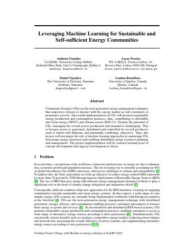

ConferenceEnergy systems2020

### [Leveraging Machine Learning for Sustainable and Self-sufficient Energy Communities](../../pages/publication/conferences/sustainable-energy-2020/index.llms.md)

**Anthony Faustine** and Pereira, Lucas and Ngondya, Isakwisa and Benabbou, Loubna

Workshop on AI for Earth Sciences, ICML 2020, Virtual

Abstract

[Link](https://scholar.google.com/citations?user=nhzHBTQAAAAJ&hl=en) [Talk](../talks/climate-change-ai-2020/index.llms.md)

Cite

@inproceedings{faustine2020leveraging, title = {{Leveraging Machine Learning for Sustainable and Self-sufficient Energy Communities}}, author = {Anthony Faustine and Pereira, Lucas and Ngondya, Isakwisa and Benabbou, Loubna}, booktitle = {Workshop on AI for Earth Sciences, ICML 2020, Virtual}, year = {2020} } Anthony Faustine and Pereira, Lucas and Ngondya, Isakwisa and Benabbou, Loubna (2020). Leveraging Machine Learning for Sustainable and Self-sufficient Energy Communities. Workshop on AI for Earth Sciences, ICML 2020, Virtual. Energy communities — groups of households and businesses that share local renewable energy resources — are emerging as a key mechanism for the energy transition. Realising self-sufficiency within such communities requires intelligent coordination of generation, storage, and consumption. This paper investigates how machine learning can support this coordination by addressing three interrelated problems: short-term solar and demand forecasting, appliance-level load disaggregation via NILM, and community-scale demand response optimisation. We propose an integrated ML pipeline connecting these modules and evaluate it on a simulated energy community with real solar irradiance and consumption data. Results demonstrate that the combined ML approach improves self-sufficiency rates by 18% compared to rule-based scheduling, with forecasting accuracy being the dominant factor in overall community performance.

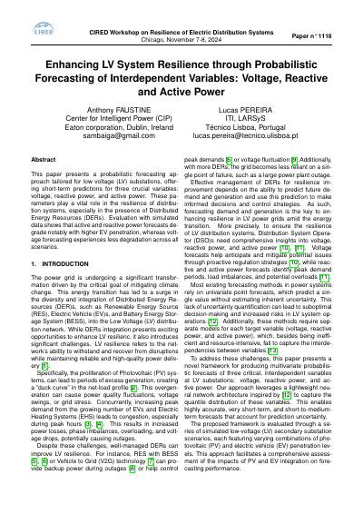

ConferenceForecasting2025

### [Enhancing LV system resilience through probabilistic forecasting of interdependent variables: voltage, reactive and active power](../../pages/publication/conferences/cired-chicago-2024/index.llms.md)

**Anthony Faustine** and Pereira, Lucas

CIRED Chicago Workshop 2024: Resilience of Electric Distribution Systems

Abstract

[Link](https://digital-library.theiet.org/doi/10.1049/icp.2024.2555) [DOI](https://doi.org/10.1049/icp.2024.2555)

Cite

[PDF](../../files/papers/enhancinglv.pdf)

@article{faustine2025enhancing, title = {{Enhancing LV system resilience through probabilistic forecasting of interdependent variables: voltage, reactive and active power}}, author = {Faustine, Anthony and Pereira, Lucas}, journal = {IET Conference Proceedings}, year = {2025}, volume = {2024}, number = {27}, pages = {27--31}, doi = {10.1049/icp.2024.2555} } Anthony Faustine and Pereira, Lucas (2025). Enhancing LV system resilience through probabilistic forecasting of interdependent variables: voltage, reactive and active power. CIRED Chicago Workshop 2024: Resilience of Electric Distribution Systems. This paper presents a probabilistic forecasting approach tailored for low voltage (LV) substations, offering short-term predictions for three crucial variables: voltage, reactive power, and active power. These parameters play a vital role in the resilience of distribution systems, especially in the presence of Distributed Energy Resources (DERs).

JournalSensing and networks2016

### [Open source cellular technologies for cost effective cellular connectivity in rural areas](../../pages/publication/articles/open-source-cellular/index.llms.md)

**Anthony Faustine** and Gabriel, M. and Shao, B.

International Journal of Computer Applications (IJCA), Vol. 145, No. 11, pp. 1-6

Abstract

[Link](https://www.ijcaonline.org/archives/volume145/number11/)

Cite

@article{faustine2016open, title = {{Open source cellular technologies for cost effective cellular connectivity in rural areas}}, author = {Anthony Faustine and Gabriel, M. and Shao, B.}, journal = {International Journal of Computer Applications (IJCA)}, year = {2016}, volume = {145}, number = {11}, pages = {1--6} } Anthony Faustine and Gabriel, M. and Shao, B. (2016). Open source cellular technologies for cost effective cellular connectivity in rural areas. International Journal of Computer Applications (IJCA), Vol. 145, No. 11, pp. 1-6. Rural communities in developing regions continue to face significant barriers to cellular connectivity due to the high capital costs of proprietary telecommunications infrastructure. This paper investigates the feasibility of open source cellular technologies — including OpenBTS, OpenBSC, and Osmocom — as low-cost alternatives for rural area coverage. We evaluate deployment architectures, spectrum requirements, hardware costs, and community network governance models. A comparative analysis of open source and proprietary solutions is conducted with respect to total cost of ownership, maintenance complexity, and quality of service. Our findings suggest that open source cellular platforms can reduce infrastructure costs by up to 70% compared to conventional approaches while delivering acceptable service quality for voice and basic data services in rural deployments.

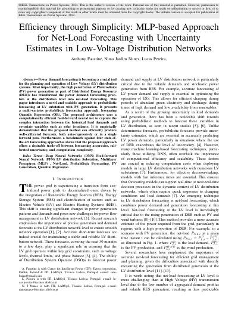

JournalForecasting2025

### [Efficiency through Simplicity: MLP-based Approach for Net-Load Forecasting with Uncertainty Estimates in Low-Voltage Distribution Networks](../../pages/publication/articles/mlpf-2025/index.llms.md)

**Anthony Faustine** and Nuno Jardim Nunes and Lucas Pereira

IEEE Transactions on Power Systems, Vol. 40, No. 1, pp. 46-5

Abstract

[Slide](../../files/slides/PosterEURONILM2019.pdf) [Link](https://ieeexplore.ieee.org/document/10529636) [DOI](https://doi.org/10.1109/tpwrs.2024.3400123)

Cite

[PDF](../../files/papers/MLPQF.pdf)

@article{faustine2025efficiency, title = {{Efficiency Through Simplicity: MLP-Based Approach for Net-Load Forecasting With Uncertainty Estimates in Low-Voltage Distribution Networks}}, author = {Faustine, Anthony and Nunes, Nuno Jardim and Pereira, Lucas}, journal = {IEEE Transactions on Power Systems}, year = {2025}, volume = {40}, number = {1}, pages = {46--56}, doi = {10.1109/tpwrs.2024.3400123} } Anthony Faustine and Nuno Jardim Nunes and Lucas Pereira (2025). Efficiency through Simplicity: MLP-based Approach for Net-Load Forecasting with Uncertainty Estimates in Low-Voltage Distribution Networks. IEEE Transactions on Power Systems, Vol. 40, No. 1, pp. 46-5. Power demand forecasting is becoming a crucial tool for the planning and operation of Low Voltage (LV) distribution systems. Most importantly, the high penetration of Photovoltaics (PV) power generation as part of Distributed Energy Resource (DER)s has transformed the power demand forecasting problem at the distribution level into net-load forecasting. This paper introduces a novel and scalable approach to probabilistic forecasting at LV substations with PV generation. It presents a multi-variates probabilistic forecasting approach, leveraging Quantile Regression (QR). The proposed architecture uses a computationally efficient feed-forward neural net to capture the complex interaction between the historical load demands and covariate variables such as solar irradiance. It is empirically demonstrated that the proposed method can efficiently produce well-calibrated forecasts, both auto-regressively or in a single forward pass. Furthermore, a benchmark against four state-of-the-art forecasting approaches show that the proposed approach offers a desirable trade-off between forecasting accuracies, calibrated uncertainty, and computation complexity.

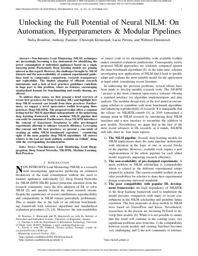

JournalNILM2023

### [Unlocking the Full Potential of Neural NILM: On Automation, Hyperparameters and Modular Pipelines](../../pages/publication/articles/deep-nilmtk-2023/index.llms.md)

Hafsa Bousbiat, **Anthony Faustine**, Christoph Klemenjak, Lucas Pereira and Wilfried Elmenreich

IEEE Transactions on Industrial Informatics, Vol. 19, No. 5, pp. 7002-7010

Abstract

[Link](https://ieeexplore.ieee.org/document/9889174) [Code](https://github.com/BHafsa/deep-nilmtk-v1) [DOI](https://doi.org/10.1109/tii.2022.3206322)

Cite

[PDF](../../files/papers/DeepNLMTK.pdf)

@article{bousbiat2023unlocking, title = {{Unlocking the Full Potential of Neural NILM: On Automation, Hyperparameters, and Modular Pipelines}}, author = {Bousbiat, Hafsa and Faustine, Anthony and Klemenjak, Christoph and Pereira, Lucas and Elmenreich, Wilfried}, journal = {IEEE Transactions on Industrial Informatics}, year = {2023}, volume = {19}, number = {5}, pages = {7002--7010}, doi = {10.1109/tii.2022.3206322} } Hafsa Bousbiat, Anthony Faustine, Christoph Klemenjak, Lucas Pereira and Wilfried Elmenreich (2023). Unlocking the Full Potential of Neural NILM: On Automation, Hyperparameters and Modular Pipelines. IEEE Transactions on Industrial Informatics, Vol. 19, No. 5, pp. 7002-7010. Nonintrusive load monitoring (NILM) techniques are increasingly becoming a key instrument for identifying the power consumption of individual appliances based on a single metering point. Particularly, deep learning (DL) models are gaining interest in this regard. However, the challenges brought by the NILM datasets and the nonavailability of common experimental guidelines tend to compromise comparison, research transparency, and replicability. The limited adoption of efficient research instruments and lack of best practices guidelines contribute in huge part to this problem, where no features, encouraging standardized formats for benchmarking, and results sharing are offered. To address these issues, we first present a brief overview of recent best practices for DL and highlight how deep NILM research can benefit from these practices. Furthermore, we suggest a novel open-source toolkit leveraging these practices, i.e., Deep-NILMTK. The proposed toolkit offers a common testing bed for NILM algorithms independently of the underlying deep learning framework with a modular NILM pipeline that can easily be customized. Furthermore, Deep-NILMTK introduces the concept of experiment templating to offer predesigned experiments allowing to enhancing research efficiency. Leveraging this concept and DL best practices, we present a case study of creating an online NILM benchmark repository1 considering eight of the most popular deep NILM algorithms. All sources relative to the tool are made publicly available on Github2 along with the corresponding documentation.

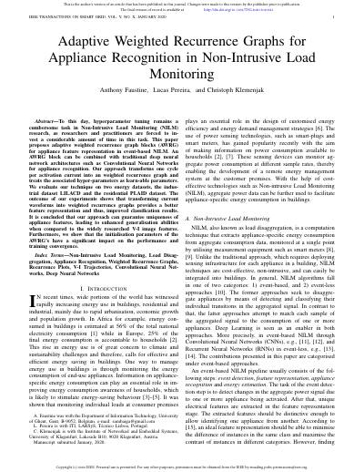

JournalNILM2021

### [Adaptive Weighted Recurrence Graphs for Appliance Recognition in Non-Intrusive Load Monitoring](../../pages/publication/articles/AWRGNILM/index.llms.md)

**Anthony Faustine** and Pereira, Lucas and Klemenjak, Christoph

IEEE Transactions on Smart Grid, Vol. 12, No. 1, pp. 398-406

Abstract

[Link](https://ieeexplore.ieee.org/document/9144492) [Code](https://github.com/sambaiga/AWRGNILM) [DOI](https://doi.org/10.1109/tsg.2020.3010621)

Cite

[PDF](../../files/papers/AWRG.pdf)

@article{faustine2021adaptive, title = {{Adaptive Weighted Recurrence Graphs for Appliance Recognition in Non-Intrusive Load Monitoring}}, author = {Faustine, Anthony and Pereira, Lucas and Klemenjak, Christoph}, journal = {IEEE Transactions on Smart Grid}, year = {2021}, volume = {12}, number = {1}, pages = {398--406}, doi = {10.1109/tsg.2020.3010621} } Anthony Faustine and Pereira, Lucas and Klemenjak, Christoph (2021). Adaptive Weighted Recurrence Graphs for Appliance Recognition in Non-Intrusive Load Monitoring. IEEE Transactions on Smart Grid, Vol. 12, No. 1, pp. 398-406. To this day, hyperparameter tuning remains a cumbersome task in Non-Intrusive Load Monitoring (NILM) research, as researchers and practitioners are forced to invest a considerable amount of time in this task. This paper proposes adaptive weighted recurrence graph blocks (AWRG) for appliance feature representation in event-based NILM. An AWRG block can be combined with traditional deep neural network architectures such as Convolutional Neural Networks for appliance recognition. Our approach transforms one cycle per activation current into an weighted recurrence graph and treats the associated hyper-parameters as learn-able parameters. We evaluate our technique on two energy datasets, the industrial dataset LILACD and the residential PLAID dataset. The outcome of our experiments shows that transforming current waveforms into weighted recurrence graphs provides a better feature representation and thus, improved classification results. It is concluded that our approach can guarantee uniqueness of appliance features, leading to enhanced generalisation abilities when compared to the widely researched V-I image features. Furthermore, we show that the initialisation parameters of the AWRG's have a significant impact on the performance and training convergence.

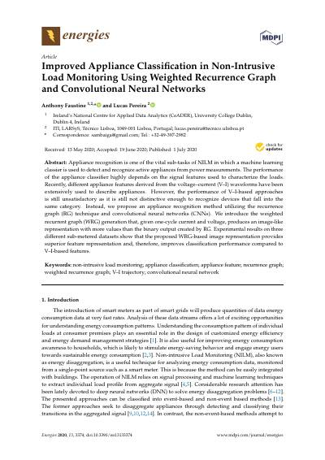

JournalNILM2020

### [Improved Appliance Classification in Non-Intrusive Load Monitoring Using Weighted Recurrence Graph and Convolutional Neural Networks](../../pages/publication/articles/WRGNILM/index.llms.md)

**Anthony Faustine** and Pereira, Lucas

Energies, Vol. 13, No. 13

Abstract

[Poster](../../files/slides/PosterEURONILM2019.pdf) [Link](https://www.mdpi.com/1996-1073/13/13/3374) [Code](https://github.com/sambaiga/WRG-NILM) [DOI](https://doi.org/10.3390/en13133374)

Cite

[PDF](../../files/papers/wrg.pdf)

@article{faustine2020improved, title = {{Improved Appliance Classification in Non-Intrusive Load Monitoring Using Weighted Recurrence Graph and Convolutional Neural Networks}}, author = {Faustine, Anthony and Pereira, Lucas}, journal = {Energies}, year = {2020}, volume = {13}, number = {13}, pages = {3374}, doi = {10.3390/en13133374} } Anthony Faustine and Pereira, Lucas (2020). Improved Appliance Classification in Non-Intrusive Load Monitoring Using Weighted Recurrence Graph and Convolutional Neural Networks. Energies, Vol. 13, No. 13. Appliance recognition is one of the vital sub-tasks of NILM in which a machine learning classier is used to detect and recognize active appliances from power measurements. The performance of the appliance classifier highly depends on the signal features used to characterize the loads. Recently, different appliance features derived from the voltage–current (V–I) waveforms have been extensively used to describe appliances. However, the performance of V–I-based approaches is still unsatisfactory as it is still not distinctive enough to recognize devices that fall into the same category. Instead, we propose an appliance recognition method utilizing the recurrence graph (RG) technique and convolutional neural networks (CNNs). We introduce the weighted recurrent graph (WRG) generation that, given one-cycle current and voltage, produces an image-like representation with more values than the binary output created by RG. Experimental results on three different sub-metered datasets show that the proposed WRG-based image representation provides superior feature representation and, therefore, improves classification performance compared to V–I-based features.

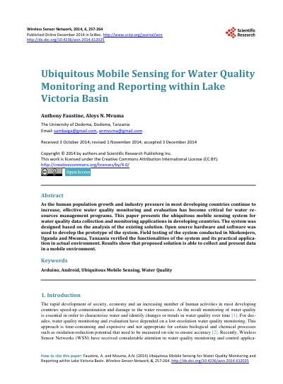

JournalSensing and networks2014

### [Ubiquitous Mobile Sensing for Water Quality Monitoring and Reporting within Lake Victoria Basin](../../pages/publication/articles/MobSensing/index.llms.md)

**Anthony Faustine** and Aloys N. Mvuma

Wireless Sensor Network, Vol. 6, No. 12, pp. 257-264

Abstract

[Link](https://doi.org/10.4236/wsn.2014.612025) [DOI](https://doi.org/10.4236/wsn.2014.612025)

Cite

@article{faustine2014ubiquitous, title = {{Ubiquitous Mobile Sensing for Water Quality Monitoring and Reporting within Lake Victoria Basin}}, author = {Faustine, Anthony and Mvuma, Aloys N.}, journal = {Wireless Sensor Network}, year = {2014}, volume = {06}, number = {12}, pages = {257--264}, doi = {10.4236/wsn.2014.612025} } Anthony Faustine and Aloys N. Mvuma (2014). Ubiquitous Mobile Sensing for Water Quality Monitoring and Reporting within Lake Victoria Basin. Wireless Sensor Network, Vol. 6, No. 12, pp. 257-264. As the human population growth and industry pressure in most developing countries continue to increase, effective water quality monitoring and evaluation has become critical for water resources management programs. This paper presents the ubiquitous mobile sensing system for water quality data collection and monitoring applications in developing countries. The system was designed based on the analysis of the existing solution. Open source hardware and software was used to develop the prototype of the system. Field testing of the system conducted in Nkokonjero, Uganda and Mwanza, Tanzania verified the functionalities of the system and its practical application in actual environment. Results show that proposed solution is able to collect and present data in a mobile environment.

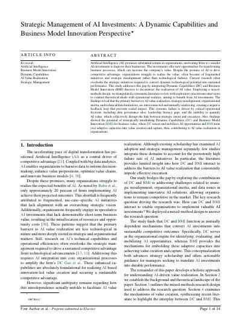

JournalSubmittedInnovation and technology management2025

### [Strategic Management of AI Investments: A Dynamic Capabilities and Business Model Innovation Perspective](../../pages/publication/articles/strategic_ai/index.llms.md)

**Anthony Faustine**, Ethna O Connor, Dr Tupokigwe Isagah, and Dr Kevin Byrne

Journal of Strategic Information Systems

Abstract

Cite

@article{faustine2025strategic, title = {{Strategic Management of AI Investments: A Dynamic Capabilities and Business Model Innovation Perspective}}, author = {Anthony Faustine and Ethna O Connor and Tupokigwe Isagah and Kevin Byrne}, journal = {Journal of Strategic Information Systems}, year = {2025} } Anthony Faustine, Ethna O Connor, Dr Tupokigwe Isagah, and Dr Kevin Byrne (2025). Strategic Management of AI Investments: A Dynamic Capabilities and Business Model Innovation Perspective. Journal of Strategic Information Systems. Artificial Intelligence (AI) promises substantial returns in organisations, motivating firms to consider AI investments to improve their businesses. The investments offer new opportunities for transforming business processes, which can increase the company’s value. Despite the promise of AI to drive competitive advantage, organisations struggle to realise its value, often because of fragmented initiatives and strategic misalignment rather than technological failures. Current research often overlooks the strategic initiatives required to convert dynamic technological potential into sustained performance. This study addresses this gap by integrating Dynamic Capabilities (DC) and Business Model Innovation (BMI) theories to deconstruct the realisation of AI value. Employing a mixed-methods design, we triangulated a systematic literature review with exploratory practitioner interviews to contrast theoretical ideals with operational realities, aiming to benefit from AI investments. The findings reveal that the primary barriers to AI value realisation, strategic misalignment, organisational inertia, and technical/data limitations, are interconnected and mutually reinforcing, creating a negative feedback loop that prevents scaled impact. This systemic failure is driven by critical operational frictions, including data governance silos, leadership literacy gaps, and the inability to quantify AI value, which collectively disrupt the link between strategic intent and execution. Also, findings showed the potential of strategically interlinking Dynamic Capabilities (DC) and Business Model Innovation (BMI) for business value, where DC senses and mobilizes AI opportunities and BMI turns over adaptive capacities into value creation and capture, thus contributing to AI value realization in organisations.

JournalNILM2019

### [On metrics to assess the transferability of machine learning models in non-intrusive load monitoring](../../pages/publication/articles/nilm-transferability/index.llms.md)

Klemenjak, Christoph and **Anthony Faustine** and Makonin, Stephen and Elmenreich, Wilfried

Energy Informatics, Vol. 2, No. 1, pp. 1-15

Abstract

[Link](https://doi.org/10.1186/s42162-019-0088-3) [arXiv](https://arxiv.org/abs/1912.06200) [DOI](https://doi.org/10.1186/s42162-019-0088-3)

Cite

@article{klemenjak2019metrics, title = {{On metrics to assess the transferability of machine learning models in non-intrusive load monitoring}}, author = {Klemenjak, Christoph and Anthony Faustine and Makonin, Stephen and Elmenreich, Wilfried}, journal = {Energy Informatics}, year = {2019}, volume = {2}, number = {1}, pages = {1--15}, doi = {10.1186/s42162-019-0088-3} } Klemenjak, Christoph and Anthony Faustine and Makonin, Stephen and Elmenreich, Wilfried (2019). On metrics to assess the transferability of machine learning models in non-intrusive load monitoring. Energy Informatics, Vol. 2, No. 1, pp. 1-15. Non-intrusive load monitoring (NILM) research has produced a rich body of machine learning approaches for appliance state detection and energy disaggregation. However, the community lacks standardised metrics for evaluating how well models trained on one dataset transfer to another. This paper addresses this gap by analysing existing evaluation metrics, identifying their limitations for cross-dataset transfer, and proposing a framework of transferability metrics grounded in information-theoretic and statistical measures. We demonstrate the framework on multiple residential energy datasets and show how commonly used metrics such as F1 score can be misleading when assessing model transferability. Our findings provide guidance for researchers on selecting appropriate metrics when reporting NILM model performance in multi-dataset settings.

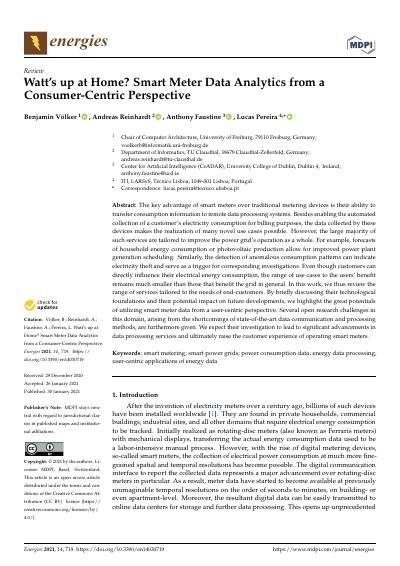

JournalNILM2021

### [Watt’s up at Home? Smart Meter Data Analytics from a Consumer-Centric Perspective](../../pages/publication/articles/WattsupHome/index.llms.md)

Völker, Benjamin, Reinhardt, Andreas, **Anthony Faustine** and Pereira, Lucas

Energies, Vol. 14, No. 3

Abstract

[Link](https://doi.org/10.3390/en14030719) [DOI](https://doi.org/10.3390/en14030719)

Cite

[PDF](../../files/papers/wattshome.pdf)

@article{vlker2021watt, title = {{Watt’s up at Home? Smart Meter Data Analytics from a Consumer-Centric Perspective}}, author = {Völker, Benjamin and Reinhardt, Andreas and Faustine, Anthony and Pereira, Lucas}, journal = {Energies}, year = {2021}, volume = {14}, number = {3}, pages = {719}, doi = {10.3390/en14030719} } Völker, Benjamin, Reinhardt, Andreas, Anthony Faustine and Pereira, Lucas (2021). Watt’s up at Home? Smart Meter Data Analytics from a Consumer-Centric Perspective. Energies, Vol. 14, No. 3. The key advantage of smart meters over traditional metering devices is their ability to transfer consumption information to remote data processing systems. Besides enabling the automated collection of a customer’s electricity consumption for billing purposes, the data collected by these devices makes the realization of many novel use cases possible. However, the large majority of such services are tailored to improve the power grid’s operation as a whole. For example, forecasts of household energy consumption or photovoltaic production allow for improved power plant generation scheduling. Similarly, the detection of anomalous consumption patterns can indicate electricity theft and serve as a trigger for corresponding investigations. Even though customers can directly influence their electrical energy consumption, the range of use cases to the users’ benefit remains much smaller than those that benefit the grid in general. In this work, we thus review the range of services tailored to the needs of end-customers. By briefly discussing their technological foundations and their potential impact on future developments, we highlight the great potentials of utilizing smart meter data from a user-centric perspective. Several open research challenges in this domain, arising from the shortcomings of state-of-the-art data communication and processing methods, are furthermore given. We expect their investigation to lead to significant advancements in data processing services and ultimately raise the customer experience of operating smart meters.

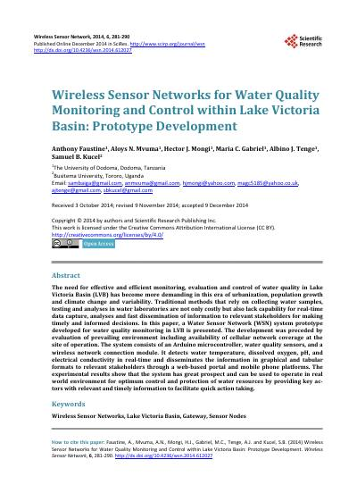

JournalSensing and networks2014

### [Wireless Sensor Networks for Water Quality Monitoring and Control within Lake Victoria Basin: Prototype Development](../../pages/publication/articles/WSNWQM/index.llms.md)

**Anthony Faustine**, Aloys N. Mvuma, Hector J. Mongi, Maria C. Gabriel, Albino J. Tenge and Samuel B. Kucel

Wireless Sensor Network, Vol. 6, No. 12, pp. 281-90

Abstract

[Slide](../../files/slides/vicres_presentation.pdf) [Link](https://doi.org/10.4236/wsn.2014.612027) [DOI](https://doi.org/10.4236/wsn.2014.612027)

Cite

@article{faustine2014wireless, title = {{Wireless Sensor Networks for Water Quality Monitoring and Control within Lake Victoria Basin: Prototype Development}}, author = {Faustine, Anthony and Mvuma, Aloys N. and Mongi, Hector J. and Gabriel, Maria C. and Tenge, Albino J. and Kucel, Samuel B.}, journal = {Wireless Sensor Network}, year = {2014}, volume = {06}, number = {12}, pages = {281--290}, doi = {10.4236/wsn.2014.612027} } Anthony Faustine, Aloys N. Mvuma, Hector J. Mongi, Maria C. Gabriel, Albino J. Tenge and Samuel B. Kucel (2014). Wireless Sensor Networks for Water Quality Monitoring and Control within Lake Victoria Basin: Prototype Development. Wireless Sensor Network, Vol. 6, No. 12, pp. 281-90. The need for effective and efficient monitoring, evaluation and control of water quality in Lake Victoria Basin (LVB) has become more demanding in this era of urbanization, population growth and climate change and variability. Traditional methods that rely on collecting water samples, testing and analyses in water laboratories are not only costly but also lack capability for real-time data capture, analyses and fast dissemination of information to relevant stakeholders for making timely and informed decisions. In this paper, a Water Sensor Network (WSN) system prototype developed for water quality monitoring in LVB is presented. The development was preceded by evaluation of prevailing environment including availability of cellular network coverage at the site of operation. The system consists of an Arduino microcontroller, water quality sensors, and a wireless network connection module. It detects water temperature, dissolved oxygen, pH, and electrical conductivity in real-time and disseminates the information in graphical and tabular formats to relevant stakeholders through a web-based portal and mobile phone platforms. The experimental results show that the system has great prospect and can be used to operate in real world environment for optimum control and protection of water resources by providing key actors with relevant and timely information to facilitate quick action taking.

[Open the PDF](#)

Close
