# Talks

27 talks · 5 conference · 7 invited · 11 teaching · 3 poster

Latest talk

[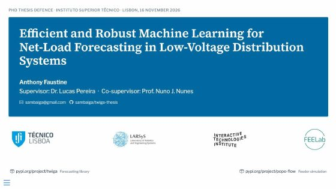](phd-defence-2026/index.llms.md)

ForecastingNov 2026

## [Efficient and Robust Machine Learning for Net-Load Forecasting in Low-Voltage Distribution Systems](phd-defence-2026/index.llms.md)

Instituto Superior Técnico Lisbon

[View the talk](phd-defence-2026/index.llms.md)

[All 27](#) [Conference 5](#) [Invited 7](#) [Teaching 11](#) [Poster 3](#)

All topics Energy systems (2) Forecasting (3) Industry (2) Machine learning (10) NILM (5) Sensing and IoT (2) Skills (3)

Clear filters

No talk matches the current filters.

## 2026 1

Forecasting Nov 2026

### [Efficient and Robust Machine Learning for Net-Load Forecasting in Low-Voltage Distribution Systems](phd-defence-2026/index.llms.md)

Instituto Superior Técnico Lisbon

32 pages, click by click

[Slides](../../files/slides/PhD_defence_2026.pdf)

## 2024 2

[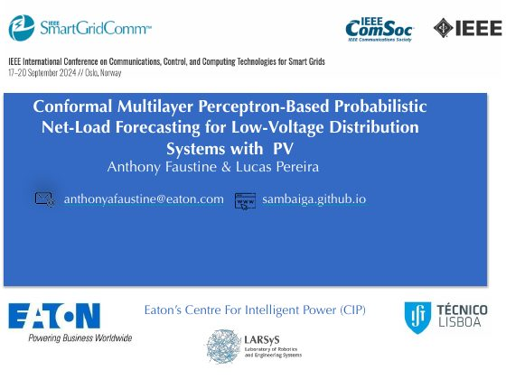](smartgridcomm-2024/index.llms.md)

**Conference**Forecasting Sep 2024

### [Conformal MLP-Based Probabilistic Net-Load Forecasting for Low-Voltage Distribution Systems with PV](smartgridcomm-2024/index.llms.md)

IEEE SmartGridComm Oslo, Norway with Lucas Pereira

14 slides

[Slides](../../files/slides/Oslo_cinference_2024.pdf)

[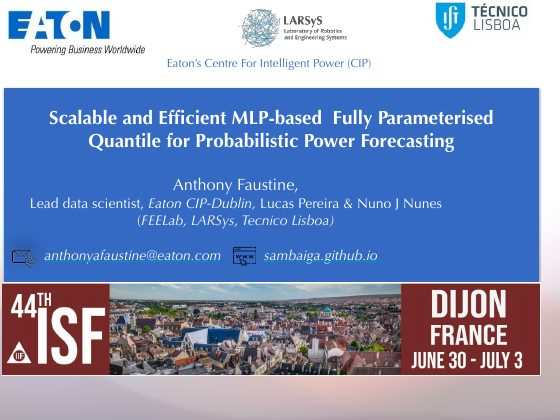](isf-2024/index.llms.md)

**Conference**Forecasting Jul 2024

### [Scalable and Efficient MLP-Based Fully Parameterised Quantile for Probabilistic Power Forecasting](isf-2024/index.llms.md)

44th International Symposium on Forecasting Dijon, France with Lucas Pereira and Nuno J. Nunes

13 slides

[Slides](../../files/slides/Dijon_conference_2024.pdf)

## 2023 1

**Invited**Energy systems 2023

### [Powering the Future: Leveraging AI for Intelligent Power Systems](https://www.linkedin.com/feed/update/urn:li:activity:7039980990345170944/)

Guest lecture, University of Galway Galway, Ireland

[Event](https://www.linkedin.com/feed/update/urn:li:activity:7039980990345170944/)

## 2022 2

**Invited**Industry 2022

### [Real-Life Application of Data-Driven Maintenance Services](https://www.linkedin.com/posts/activity-6908006815683203072-St0X)

Guest lecture, University of Galway Galway, Ireland

[Event](https://www.linkedin.com/posts/activity-6908006815683203072-St0X)

**Invited**Industry 2022

### Real-Life Application of Data-Driven Maintenance Services

IMR webinar series with Chris Judge and Dermot Murphy

[Video](https://www.youtube.com/watch?v=zSEhSYmhgDc)

## 2021 2

[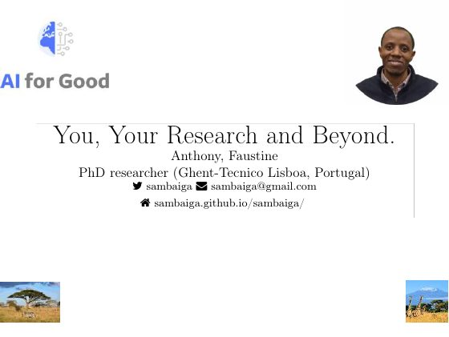](you-your-research-and-beyond-2021/index.llms.md)

**Invited**Skills 2021

### [You, Your Research and Beyond](you-your-research-and-beyond-2021/index.llms.md)

Guest lecture, University of Dodoma (CIVE) Dodoma, Tanzania

27 slides

[Slides](../../files/slides/BeyondPhD.pdf)

[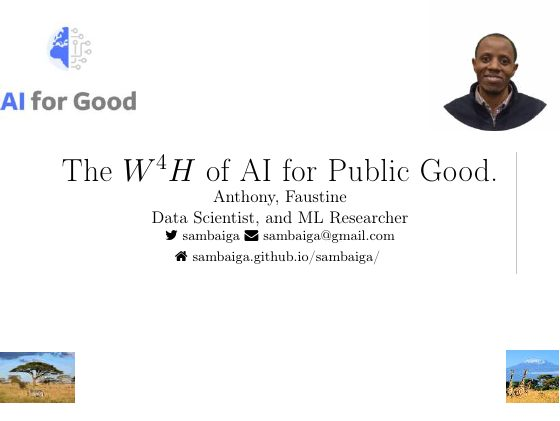](ai-for-public-good-2021/index.llms.md)

**Invited**Machine learning 2021

### [The W4H of AI for Public Good](ai-for-public-good-2021/index.llms.md)

Guest lecture, University of Dodoma (CIVE) Dodoma, Tanzania

26 slides

[Slides](../../files/slides/AI4Public_slide.pdf)

## 2020 6

[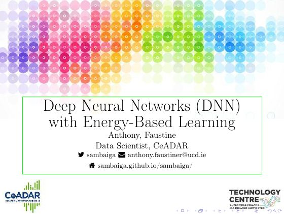](energy-based-learning-2020/index.llms.md)

**Invited**Machine learning Sep 2020

### [Deep Neural Networks with Energy-Based Learning](energy-based-learning-2020/index.llms.md)

CeADAR technical talk

31 slides

[Slides](../../files/slides/DNN-EBM2020.pdf) [Video](https://www.youtube.com/watch?v=77O16TK7kZw)

[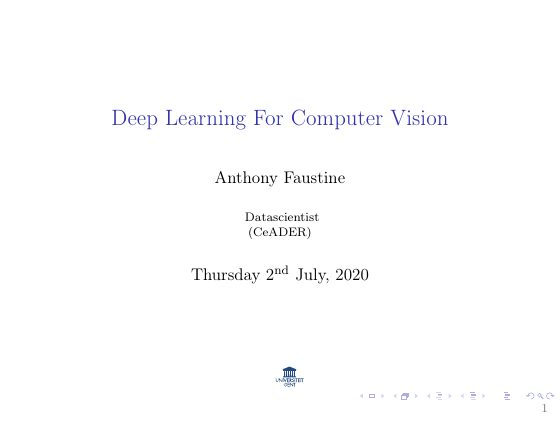](deep-learning-for-vision-2020/index.llms.md)

**Teaching**Machine learning Jul 2020

### [Deep Learning for Computer Vision](deep-learning-for-vision-2020/index.llms.md)

CeADAR

47 slides

[Slides](../../files/slides/DeepVision.pdf)

[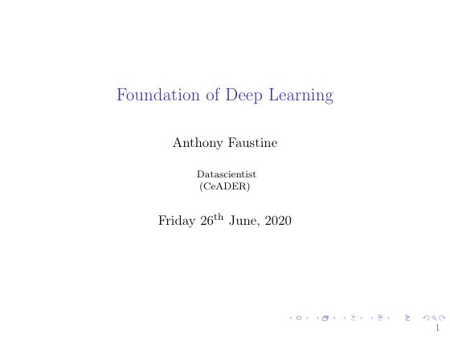](deep-learning-foundation-2020/index.llms.md)

**Teaching**Machine learning Jun 2020

### [Foundation of Deep Learning](deep-learning-foundation-2020/index.llms.md)

CeADAR

67 slides

[Slides](../../files/slides/DeepLearningFoundation.pdf)

[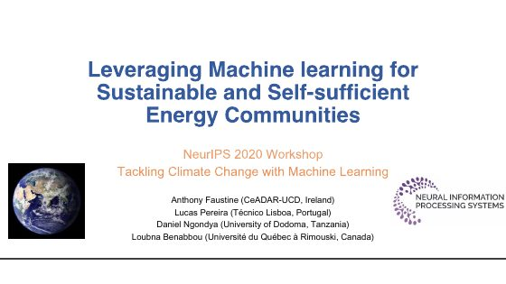](climate-change-ai-2020/index.llms.md)

**Conference**Energy systems 2020

### [Leveraging Machine Learning for Sustainable and Self-sufficient Energy Communities](climate-change-ai-2020/index.llms.md)

NeurIPS 2020 Workshop on Tackling Climate Change with Machine Learning with Lucas Pereira, Daniel Ngondya and L. Benabbou

11 slides

[Slides](../../files/slides/climateai2020.pdf) [Video](https://www.youtube.com/watch?v=qvgIjTKmhfc)

[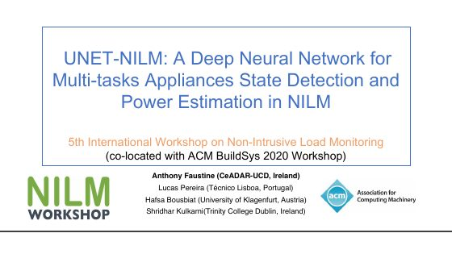](unet-nilm-2020/index.llms.md)

**Conference**NILM 2020

### [UNet-NILM: A Deep Neural Network for Multi-Task Appliance State Detection and Power Estimation in NILM](unet-nilm-2020/index.llms.md)

5th International Workshop on NILM, with ACM BuildSys 2020 with Lucas Pereira, Hafsa Bousbiat and Shridhar Kulkarni

11 slides

[Slides](../../files/slides/UNENT-NILM2020.pdf) [Video](https://www.youtube.com/watch?v=UpZDX2hU3-A)

[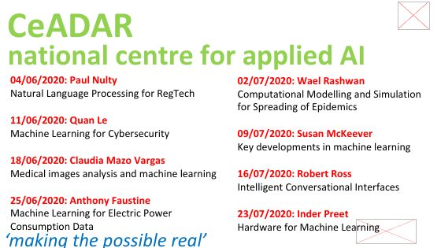](energy-disaggregation-2020/index.llms.md)

**Invited**NILM 2020

### [Machine Learning for Energy Disaggregation](energy-disaggregation-2020/index.llms.md)

CeADAR online seminar series

10 slides

[Slides](../../files/slides/MLNILMCeADAR.pdf) [Video](https://www.youtube.com/watch?v=LL4clcjwSaE)

## 2019 1

[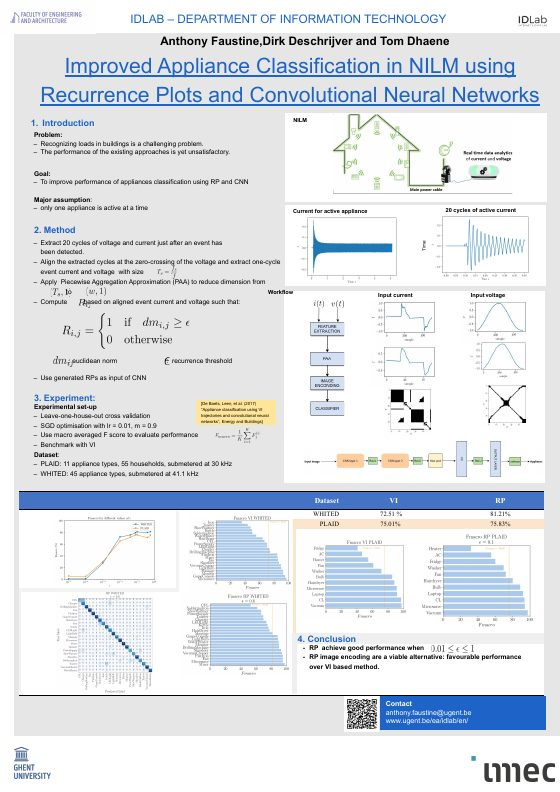](euro-nilm-2019/index.llms.md)

**Poster**NILM 2019

### [Improved Appliance Classification in NILM Using Recurrence Plots and Convolutional Neural Networks](euro-nilm-2019/index.llms.md)

EU NILM Workshop Thessaloniki, Greece with Dirk Deschrijver and Tom Dhaene

A0 poster

[Slides](../../files/slides/PosterEURONILM2019.pdf) [Video](https://www.youtube.com/watch?v=xDEHwC2QmuU&t=353)

## 2018 3

[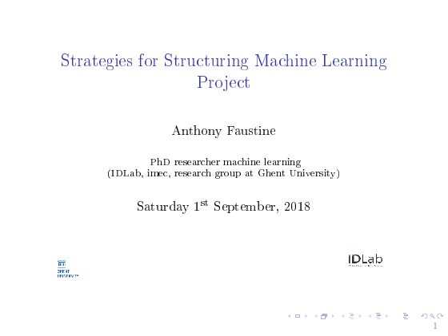](ml-project-strategy-2018/index.llms.md)

**Teaching**Machine learning Sep 2018

### [Strategies for Structuring Machine Learning Projects](ml-project-strategy-2018/index.llms.md)

Bootcamp, University of Dodoma (CIVE) Dodoma, Tanzania

51 slides

[Slides](../../files/slides/MLstrategy.pdf)

[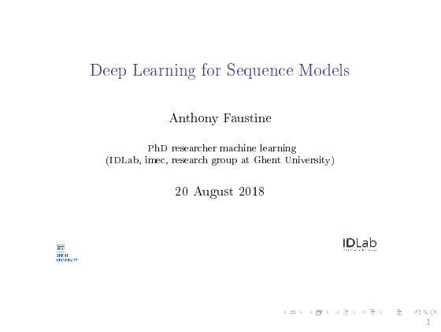](deep-sequence-models-2018/index.llms.md)

**Teaching**Machine learning Aug 2018

### [Deep Learning for Sequence Models](deep-sequence-models-2018/index.llms.md)

Bootcamp, University of Dodoma (CIVE) Dodoma, Tanzania

34 slides

[Slides](../../files/slides/DeepSeq.pdf)

[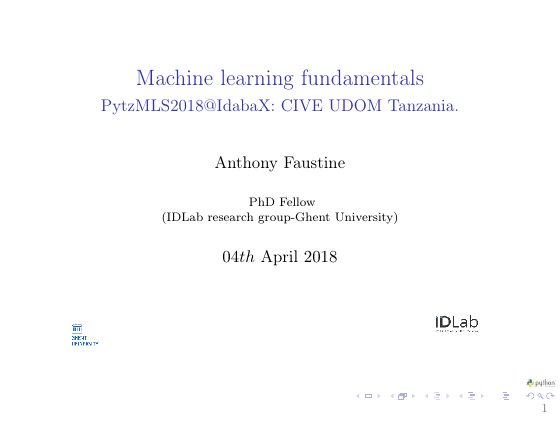](ml-fundamentals-2018/index.llms.md)

**Teaching**Machine learning Apr 2018

### [Machine Learning Fundamentals](ml-fundamentals-2018/index.llms.md)

IndabaX Tanzania (PytzMLS2018) University of Dodoma, Tanzania

47 slides

[Slides](../../files/slides/MLfundamentals.pdf)

## 2017 7

**Teaching**Machine learning Oct 2017

### [Foundations of Machine Learning and Deep Learning](https://speakerdeck.com/sambaiga/foundation-of-machine-learning-and-deep-learning)

Pythontz event, University of Dodoma (CIVE) Dodoma, Tanzania

[Event](https://speakerdeck.com/sambaiga/foundation-of-machine-learning-and-deep-learning)

**Poster**NILM Sep 2017

### Hybrid HMM-Deep Learning Models for Low-Sampling Energy Disaggregation

Deep Learning Indaba Summer School 2017 Johannesburg, South Africa

**Teaching**Skills Sep 2017

### [Workshop on LaTeX for Scientific Writing](https://github.com/sambaiga/Latex4ScientificWriting)

NM-AIST Arusha, Tanzania

[Event](https://github.com/sambaiga/Latex4ScientificWriting)

**Teaching**Machine learning Aug 2017

### [Practical Approaches to Using Scikit-learn for Machine Learning Projects](https://github.com/sambaiga/python4MachineLearning-NMAIST)

Pythontz event, NM-AIST Arusha, Tanzania with Neema Mduma

[Event](https://github.com/sambaiga/python4MachineLearning-NMAIST)

**Teaching**Machine learning Aug 2017

### [Python for Data Science](https://github.com/neylicious/python4MachineLearning-NMAIST)

Arusha Technical College Arusha, Tanzania with Neema Mduma, Dina Machuve and Eliyah Masesa

[Event](https://github.com/neylicious/python4MachineLearning-NMAIST)

[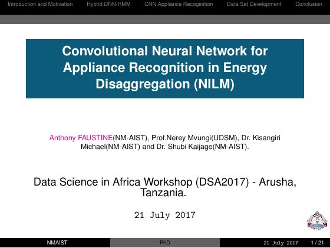](dsa-2017/index.llms.md)

**Conference**NILM Jun 2017

### [Convolutional Neural Network for Appliance Recognition in Energy Disaggregation (NILM)](dsa-2017/index.llms.md)

Data Science Africa 2017 Arusha, Tanzania with Nerey Mvungi, Kisangiri Michael and Shubi Kaijage

24 slides

[Slides](../../files/slides/ConvNILM.pdf) [Video](https://www.youtube.com/watch?v=8TCCpEJI2cg)

**Teaching**Skills Mar 2017

### Training Workshop on LaTeX for Scientific Writing

University of Dodoma (CIVE) Dodoma, Tanzania

## 2015 1

**Teaching**Sensing and IoT Dec 2015

### Building the Internet of Things with Arduino and the Atmel AVR Microcontroller

Four-week course, University of Dodoma (CIVE) Dodoma, Tanzania

## 2014 1

[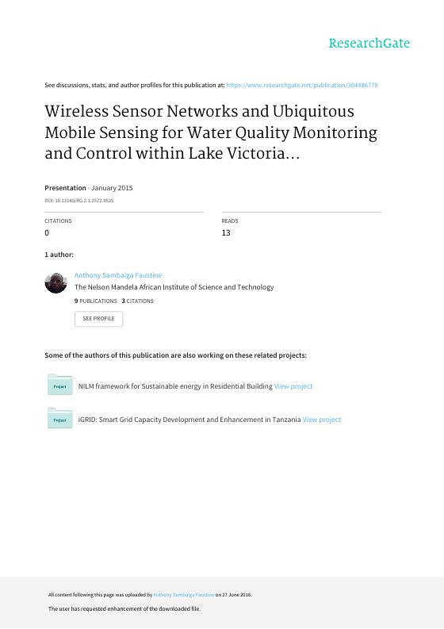](vicres-2014/index.llms.md)

**Poster**Sensing and IoT May 2014

### [Wireless Sensor Networks and Mobile Sensing for Water Quality Monitoring and Reporting](vicres-2014/index.llms.md)

VICRES Scientific Joint Conference 2014 Entebbe, Uganda

32 pages

[Slides](../../files/slides/vicres_presentation.pdf)

Slides are shared under CC BY 4.0, like the rest of the site.
